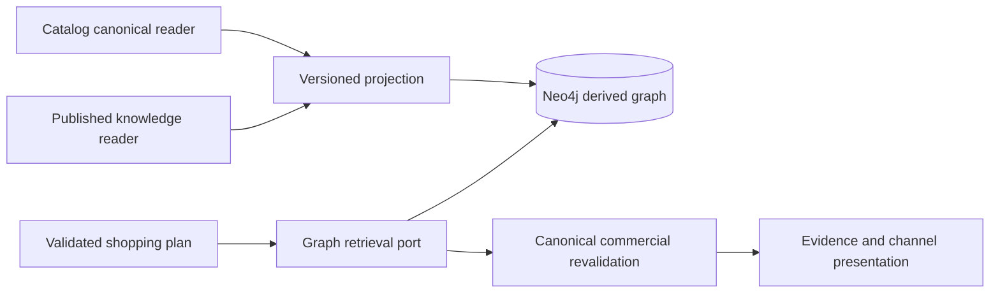

# GraphRAG implementation design

The graph is a derived read model. Catalog and knowledge modules retain ownership of PostgreSQL data. Existing public ports expose canonical projections and revalidation; GraphRagModule never queries another module's private tables.

- Cypher templates are fixed source code. Values, vectors, IDs and criteria are parameters. No endpoint accepts Cypher text.
- Tenant-scoped MATCH precedes vector ranking. Exact vector similarity within a bounded tenant slice avoids cross-tenant ANN starvation. A selection remains explicitly partial.
- The graph embedding model is identified separately from existing PostgreSQL embeddings. No incompatible vectors are mixed.
- Projection owns Product, Variant, Attribute, Category, Document and Chunk nodes with composite tenant/canonical identities, public provenance, observed source revision and tombstones. A source lock and revision comparison precede changes.
- Neo4j read and write credentials are separate. Production admission checks the reader's actual roles; READ routing is not treated as authorization.
- A disabled or unlisted merchant never opens a graph connection or loads the embedding model. An unavailable graph retains the canonical PostgreSQL path.
- Semantic candidates are a retrieval hint. The canonical catalog revalidates IDs and the same variant, stock, price, attributes and approved ratings. Results are labelled related and limited.
- Knowledge sources are reread through the owning module and matched to current public content. No private chat, buyer identity, address, authentication or payment record enters the graph.
- Lifecycle integration uses the existing event infrastructure and reconciliation. Indexing failures do not propagate into commercial mutations.
- Local proof uses an isolated Neo4j Community container with two synthetic tenants. Its administrative test credential does not satisfy production reader admission. Production activation remains off until its own infrastructure checks pass.

No new user interface or binding capture belongs to this backend feature. Existing WhatsApp/storefront presentation remains the integration surface.
