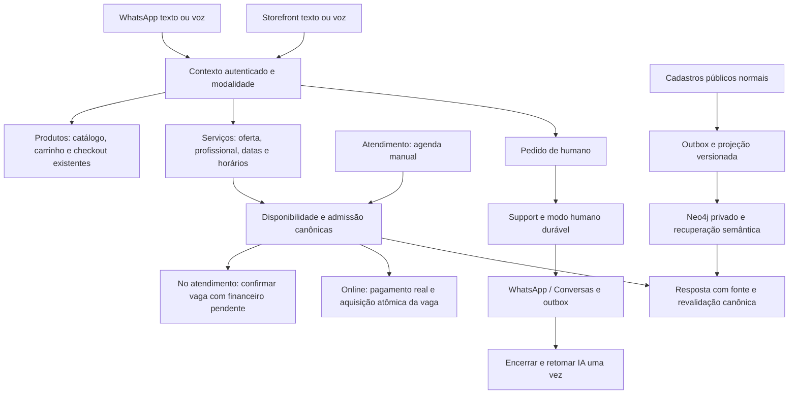

# Service Businesses, WhatsApp Conversations and Generic Business RAG Design

**User-directed public service browsing refinement (2026-11-24):** user: "nao tem nada haver isso de se identificar para ver os profissionais e horarios isso e um erro torna burocratico nao quero isso". Services, published professionals, dates and slots are browsable without buyer identification, login, OTP or buyer JWT. Ask for identification or missing registration data only when the buyer proceeds to confirmation/reservation or payment that needs it. Public reads retain trusted merchant/origin/conversation scope, canonical publication/availability/version checks and private-data boundaries. They create no buyer identity, booking hold, appointment or payment. Buyer writes retain verified identity and final capacity/financial authority; product journeys are unchanged. This direct instruction authorizes corresponding behavior/test expectation changes without another approval question. Earlier auth-before-browse evidence is historical for the revised behavior; no new criterion/task or release approval is implied.

**Spec**: `.specs/features/whatsapp-service-booking-business-rag/spec.md`
**Status**: Ready for task review, not implemented
**Date**: 2026-11-14
**Scope**: 71 criteria; original 47 approved, later explicit refinements recorded in context.md.

## Decision and Baseline

Evoluir os módulos existentes. A modalidade `products|services` seleciona regras de negócio diferentes no servidor, WhatsApp, storefront e dashboard. A jornada de produtos já aprovada deve ser preservada. Reutilizar componentes não significa compartilhar políticas financeiras ou de capacidade incompatíveis.

O usuário esclareceu a abordagem após a comparação inicial: cadastros normais alimentam o contexto; Sobre a empresa fica em Dados da empresa; Conversas fica no WhatsApp. Não haverá central de RAG. Atendimento é a gestão exclusiva de serviços.

Base API: `C:/tmp/zyon-whatsapp-final-prod-20261028`, HEAD `7229739c7b0da6bbe8da9a7746090e48ae81a7e7`. Não contém dashboard. Frontend inspecionado no workspace principal, HEAD `ce5fa9505148fb20bbc5e707a7f8197669ecb088` mais alterações concorrentes. Não há prova de equivalência entre as bases. T1 reconcilia a fonte completa em checkout isolado e registra manifestos antes de editar aplicação. Não copiar indiscriminadamente o workspace nem resetar trabalho concorrente.

Três revisões somente leitura em `C:/Users/Admin/Desktop/AACP/.audit/service-plan-20261114/`: agenda-review.md, dashboard-review.md e rag-whatsapp-review.md. As decisões do usuário prevalecem sobre perguntas históricas desses relatórios. Nenhum AD-NNN ativo encontrado; nenhuma lição confirmada. Nenhuma implementação ou ação remota integra esta revisão.

## Architecture Overview

Regras visíveis, contagens, filtros, política, preços e vagas ficam em funções/use cases testáveis. A UI apresenta resultados. A IA não cria permissão, modalidade, pagamento aprovado ou disponibilidade pela linguagem.

## Business Capability and Compatibility

2026-11-16 additions use the same architecture. The private staff WhatsApp alert has separate settings/receipt persistence from public FAQ and operator replies, and a minimal authenticated Conversations link. Agendamentos is a separate services-only daily board over ServiceAppointment; Atendimento remains administration. Services replace the primary Orders navigation without deleting historical orders; products retain their existing Orders flow. See support-appointments-addendum-20261116.md for scope, locks, privacy and evidence boundaries. The directly requested additions bring the current plan to78 criteria/103 tasks; the original dated scope above is retained as history.

- Modalidade canônica persistida no signup e retornada no perfil. Segmento, plano e modalidade são eixos distintos. Escolha exclusiva acessível.
- Empresas existentes de produtos conservam a jornada atual. Serviços legados exigem classificação/migração explícita. Ambiguidade ou catálogo misto não será convertido ou apagado silenciosamente; novas ações de agenda ficam desabilitadas até resolver, preservando operação histórica.
- Guarda de modalidade e autorização no servidor. Tenant vem de ator/sessão confiável. Mudança com registros incompatíveis retorna conflito; não apaga histórico.
- Aplicar modalidade nos escritores canônicos do catálogo, incluindo create/update/import/publicação e public API. Novas ofertas incompatíveis são recusadas sem invalidar carrinhos, snapshots ou pagamentos históricos; testar cada entrada e impedir bypass.
- Ativação por empresa após provas. Desativar novas reservas conserva consultas, cancelamentos autorizados, compromissos e regularização/webhooks de pagamentos já iniciados.
- Produto conserva frete, estoque, pagamento antecipado, recibos, estados e autoridade do carrinho. Serviço não produz frete nem saída de estoque físico.
- Prova obrigatória no mesmo candidato: produtos e serviços em tenants distintos, ambos os canais, com regressões de comércio bloqueantes. Não mudar regras comerciais aprovadas para acomodar agenda.

## Code Reuse Analysis

| Existing component | Location | Reuse and boundary |
| --- | --- | --- |
| Ofertas/categorias | catalog; Product/ProductCategory | Serviço continua oferta canônica service, preço na variante; categoria não é capacidade. |
| Duração/fuso | catalog/domain/services/service-schedule.ts | Reutilizar conversão/validação; substituir disponibilidade por variante por autoridade compartilhada. |
| Locks/holds | shared/bookings/service-slot-holds.service.ts; redis-service-slots.ts | Profissional como recurso no ramo services; produto preservado. |
| Fulfillment pago | shared/persistence/order-fulfillment.ts | Adaptar online aprovado; não relaxar guarda global de pedido pago. |
| Estados operacionais | operations/domain/order-fulfillment.ts | Reutilizar scheduled/in_service/completed/no_show e auditoria. |
| Atendimento humano | support/application/support-handoff.service.ts; send-ticket-message.use-case.ts | Tickets, dedupe e outbox existentes; novo vínculo/envio real do canal. |
| Sessão WhatsApp | whatsapp-channel/infrastructure/repositories/prisma-whatsapp-session.repository.ts | Manter lifecycle active; modo humano separado e versionado. |
| Grafo | graph-rag/application/graph-sync.service.ts; graph-projection.service.ts | Ampliar fontes, trabalho durável e gateway Community privado com consultas controladas. |
| Sobre a empresa | Merchant.storeSettings.company.description | Campo existente, limite 1.200 caracteres; corrigir validação/roundtrip sem coluna duplicada. |
| Dashboard | DashboardShell, RouteGuard, TabBar, SupportChatDrawer e filtros | Nova rota Atendimento; conversas operacionais separadas da permissão de credenciais. |

Módulos API relativos a `apps/api/src/modules/`; shared em `apps/api/src/shared/`. Frontend relativo à fonte completa que T1 reconciliar.

## Data Models

Contratos propostos, não entidades já implementadas. Migração expansiva, FKs compostas e índices incluem merchantId; novos modelos entram no isolamento tenant.

T4 co-localiza o registro declarativo mínimo dos modelos na proteção tenant para manter o contrato existente de alinhamento. Não conclui o isolamento só pela lista: T5 comprova SQL/FKs reais e T6 middleware/DB/rollback. Nenhuma rota produtiva artificial será criada para provar Prisma; cada controller posterior deve trazer suas próprias negativas HTTP no mesmo commit. Schema puro usa validate/generate/build em T4, sem teste de texto inventado.

Modalidade persistida inclui businessModeSelectedAt e businessModeNeedsReview. O default products conserva empresas de produtos; dados legados de serviço/mistos devem ser marcados para revisão explícita na migração e pelo resolver. Não se atribui profissional nem política de pagamento a essas linhas. OAuth preliminar conserva estado pendente até concluir a escolha. A política opcional começa sem valores escolhidos e com admissão desabilitada.

| Model | Canonical fields and invariant |
| --- | --- |
| Merchant capability/policy | businessMode; holdEnabled; holdMinutes positivo se ativo; paymentMode online/at_attendance; version/configuredAt. Sem política de pagamento habilitada silenciosamente. |
| ServiceProfessional | tenant/id, publicName/profile, active/published, timeZone. Não exige usuário de login; desativação preserva história. |
| ProfessionalService | profissional e Product service da mesma empresa; duração/preço permanecem na oferta. |
| ProfessionalAvailability | grade recorrente, intervalo de vigência, fuso/version. Janela de consulta limitada, não materializar agenda infinita. |
| AvailabilityException | one_off/block; tenant/profissional, início/fim/fuso, ator/version. Exceção não é agendamento; bloqueio não cancela compromisso. |
| ServiceAppointment | tenant/profissional, oferta/variante, cliente/contato, início/fim/fuso, snapshots preço/duração/política, origem, operationalStatus, version/idempotencyKey. Referências opcionais a pedido/unidade/pagamento. |
| AppointmentPayment | vínculo a tentativa/agendamento, modo, amountCents/currency, status, evidência PSP ou recibo local. Financeiro separado de comparecimento. |
| AttendanceReceipt | valor/forma/moeda, operador, instante, idempotencyKey. Sem providerPaymentId fictício. |
| AppointmentAudit/Outbox | comando/evento, versão, ator/origem, antes/depois; gravados atomicamente com transição. |
| WhatsApp handoff binding | tenant/config/conversa/sessão/ticket; mode ai/waiting_human/human, epoch. Separado de Session.status. |
| PublicSourceWork | tenant/sourceType/id/version/hash/publication, estado, tentativas/erro/indexedAt. Retry e tombstone duráveis. |

Appointment será autoridade única de capacidade confirmada. `ServiceReservation` vira projeção compatível dos pedidos antigos; não manter duas decisões independentes. Backfill vincula reservas anteriores a recursos explícitos; não adivinha profissional. Ativação só após atualizar todos os escritores.

AppointmentPayment é vínculo de alocação, não uma nova cobrança por unidade. Um PaymentIntent canônico pode financiar várias unidades/agendamentos, como já ocorre em order-fulfillment.ts. A chave deduplica por appointment e fonte financeira; intent/provider não são globalmente únicos nessa tabela. amountCents representa a parcela da unidade e a soma das alocações deve respeitar a base canônica, sem copiar o total para cada linha. T35 deve validar/deduplicar a evidência única em PaymentIntent e seu journal; KPIs devem contar recebimento/alocação uma vez, inclusive ao filtrar profissionais. Recibos locais usam sua própria identidade auditável, sem inventar confirmação PSP. T5 cobre a cardinalidade e T35/KPI cobrem a autoridade/soma.

Intervalos `[startsAt,endsAt)` UTC com fuso IANA registrado. Adjacência permitida; sobreposição proibida entre serviços do mesmo profissional. Preço/duração/política congelados no agendamento, sem reescrever história ao editar a oferta.

## Availability and Booking Interfaces

Contratos novos em catalog/application e shared/bookings, adaptados por HTTP/WhatsApp/storefront:

| Interface | Responsibility |
| --- | --- |
| getPublishedProfessionals(publicContext, offer) | Anonymous published same-merchant professional projection; no private profile, login, OTP or synthetic buyer. |
| getAvailableDates(publicContext, offer, professional, window) | Anonymous read of published same-merchant capacity; bounded window and server timezone/clock, no buyer identity requirement. |
| getAvailableSlots(publicContext, offer, professional, date) | Anonymous read of only that date; canonical duration/start/end/policyVersion, errors distinct from empty. |
| prepareAppointment(ctx, selection) | Revalidar modalidade/vínculo/publicação/valores; criar lease só quando habilitado. |
| confirmAppointment(ctx, selection, key) | Admissão única transacional; lease quando configurado e capacidade final sempre. |
| createManualAppointment(ctx, input, explicitOneOff?) | Mesma política; avulso e agendamento na mesma transação, rollback conjunto. |
| blockAvailability(ctx, interval) | Mesmo lock; negar conflito com compromisso confirmado. |
| transitionAppointment(ctx, id, version, action) | Início/conclusão/ausência/cancelamento/remarcação auditados. |
| recordAttendanceReceipt(ctx, id, receipt, key) | Operador autorizado e registro financeiro real sem mudar comparecimento. |

Lock transacional por tenant/profissional; ordenar recursos quando múltiplos. Comprador, manual, bloqueios, remarcação, webhook e legado usam mesma admissão. Redis acelera lease, não substitui revalidação final no banco. Remarcação adquire destino/libera origem atomicamente; falha preserva original.

Public service/professional/date/slot reads use the existing trusted merchant plus origin/conversation/embed context without buyer identification. Keep their canonical publication, link, window, policy and availability checks separate from buyer writes; do not expose private agenda or buyer records. The read-only selection/review creates no hold or checkout. At the explicit booking/reservation/confirmation step, resolve real buyer identity or missing registration data and use the original authenticated prepare/confirm/payment authority, including revalidation. Administrative grade/exception/manual/transition/receipt controllers keep their existing authentication, tenant roles and expectedVersion. No fake buyer, JWT override or public writer is introduced.

### Four Policy Combinations

| Hold | Payment | Outcome |
| --- | --- | --- |
| On | Online | Lease com vencimento do servidor; pagamento real + admissão confirmam. TTL não libera compromisso final. |
| Off | Online | Sem promessa provisória; preparação/resume não exigem lease; confirmar capacidade ao pagamento. |
| On | At attendance | Lease durante escolha; confirmar ocupa vaga e cria pendência, sem PSP. |
| Off | At attendance | Admissão final disputa vaga; conflito sem cobrança/confirmar falsamente. |

Duração vem da política validada, sem dez minutos hardcoded para todas as empresas. Mudança de policyVersion exige novo resumo/aceite. Pagamento aprovado sem vaga vira regularização explícita, com evidência e vínculo humano; não confirmar falsamente, cobrar de novo ou declarar reembolso inexistente. Cancelamento/remarcação não são reembolso automático.

Estados operacionais: scheduled, in_service, completed, no_show, cancelled. Awaiting_payment é tentativa, sem vaga final. Financeiro independente: pending, provider_confirmed, recorded_at_attendance e devoluções conforme fatos. Atendimento pode ser realizado com recebimento local pendente. Pagamento não comprova presença; relógio não comprova ausência.

## Buyer Journeys and Screens

Produtos preservam catálogo, busca/comparação, avaliações, fotos, detalhes antes de Adicionar, carrinho, cross-sell curto após cada adição, identidade/endereço, frete e pagamento. Animação primeiro, contagem correta e menus hierárquicos continuam. Agenda não substitui o checkout físico.

Services: published offer -> professional -> dates -> that date’s slots -> canonical review, all without buyer identification. Only the explicit transition into booking/reservation/confirmation/payment requests real identity or missing required registration data; then revalidate through the existing writers. Lateral questions retain selection; ambiguous text/voice asks for current public choices. RAG never reserves or charges. Existing Pix/card paths and server authority remain; empty/loading/error/conflict/stale states remain distinct and no read promises a held slot.

### Atendimento

Nova rota proposta `#service-attendance`, service-only, com deep link/reload/back. Atual entrada `support`, chamada Atendimento, vira **Suporte**, preservando rota, FAQ e chamados.

| Tab | Content |
| --- | --- |
| Agenda | Dia/semana/lista, filtros profissional/categoria/estado; manual/detalhe/iniciar/concluir/ausência; estados financeiro e operacional separados. |
| Profissionais | Cadastro/edição/ativação/publicação, fuso e vínculos com ofertas. |
| Categorias | Reuso de ProductCategory e serviços associados, sem agenda por categoria. |
| Disponibilidade | Grade recorrente, avulsos, bloqueios e preview dos mesmos slots dos canais. |
| Configurações | Bloqueio/duração, online/no atendimento e links às políticas existentes. |

Manual escolhe cliente/contato, serviço/profissional/data/hora. Fora da grade, operador confirma avulso na mesma tela; sem sobreposição ou bypass financeiro. Online mostra pendência/link até evidência exigida. Ofertas e preço permanecem no catálogo, rotulado Serviços; não duplicar cadastro de preço em Atendimento. Preservar história de pedidos ao ajustar navegação.

### WhatsApp Conversations

Aba em WhatsAppSellerPage para ambas modalidades, reutilizando suporte. Staff pode operar conversas sem acesso a tokens/conexão/templates. Permissão administrativa de configuração permanece distinta.

Handoff: ticket + vínculo + modo/epoch atômicos antes de confirmar encaminhamento. Entradas no modo humano são persistidas com dedupe, sem IA/cart mutation. **Não usar Session.status=handoff**: findActiveByPhone filtra active e a criação renovaria o estado no próximo input.

Fence antes da geração, de cada dispatch e da retomada de mensagem preparada; takeover invalida resposta pendente. Claim CAS evita dois operadores. Fechar valida ticket ativo, muda modo/epoch e cria uma única notificação de retorno atomicamente. Ticket antigo não reativa outro caso.

SendTicketMessage hoje persiste e WebSocket não prova entrega. Bridge outbox novo envia à thread autenticada, com clientMessageId/providerMessageId. queued/accepted/delivered/read/failed/unknown separados. Timeout incerto não gera retry cego. Respeitar conexão/janela/templates já suportados; mensagem salva não aparece falsamente lida.

## Automatic Generic Business Knowledge

Sobre a empresa usa descrição existente de 1.200 caracteres. Validar todas as entradas/mapear respostas; omissão preserva, string vazia limpa, inválido não grava parcialmente. UI em Dados da empresa: salvar/reabrir/limpar.

Allowlist pública: apresentação/ramo, contatos comerciais, horário geral, FAQ/políticas publicadas, serviços e perfis profissionais publicados. Agenda privada, motivo de bloqueio, pacientes/clientes, operadores, credenciais, chats e pagamentos ficam fora.

Gravação canônica + outbox → worker por tenant/sourceType/id/version → projeção/hash/embedding. Ampliar tipos hoje faq/policy, ligar escritores reais, backfill/reconciliador e tombstones. Falha indexação preserva cadastro e deixa retry observável. Sem central manual de RAG.

Proveniência conserva tenant/sourceType/id/version/hash/model/publication até auditoria. GraphKnowledgeReader hoje perde metadados; revalidar publicação/hash canônico inclusive fallback sem grafo. Fonte retirada/antiga/estrangeira não fundamenta resposta atual.

Semântica encontra informação/relações; templates Cypher aprovados, parametrizados, tenant, limite e timeout executam no gateway Community privado. IA sem escrita/Cypher livre. Ferramentas canônicas confirmam preço/profissional/vaga. Texto recuperado não ganha autoridade operacional.

Ausência, contradição e falha têm respostas próprias; esclarecer ou oferecer humano. Neurologia, salão e consultoria são fixtures do mesmo motor. Informação profissional individual exige humano; não prometer diagnóstico/prescrição.

## Service Metrics Contract

DTO: modalidade, moeda/fuso, período `[start,end)`, asOf, filtros, dataStatus e base temporal por métrica. Produtos mantêm contrato/fórmulas atuais. Não renomear CompletedOrder como serviço realizado.

| Metric | Definition |
| --- | --- |
| Agendamentos | Coorte startsAt no fuso da empresa, cada appointment uma vez por estado. Tentativa/hold não contam como confirmado. |
| Concluídos/ausências | Só transições explícitas, não pagamento/relógio. |
| Ocupação | Minutos confirmados recortados ao período / união dos minutos ofertados por profissional, descontados bloqueios. Ofertas compartilhadas não duplicam capacidade; denominador 0 = não calculável. |
| Valor agendado | Snapshot de compromissos da coorte declarada, exclui tentativas/cancelados; é previsão. |
| A receber | Saldo auditável asOf da coorte filtrada; não somar snapshots diários como novos recebíveis. |
| Recebido | Valor dos serviços efetivamente pagos no período financeiro, com descontos efetivos e sem taxas adicionadas ao comprador, deduplicado por evidência PSP/local. Exemplo100+taxa2 resulta100. Base temporal distinta da agenda; devoluções separadas; alocação incompleta fica explícita. |
| Realizado, se exibido | Serviço completed explícito, com base temporal indicada; não substitui recebido. |

Mesmos filtros tenant/período/profissional/categoria nos totais/detalhes/séries. Superfícies antigas ficam exclusivas de produtos ou recebem read model próprio de serviço. Não herdar fuso do servidor. Erro/parcial/ausência não viram zero ou porcentagem inventada.

## Error Handling Strategy

| Scenario | Response |
| --- | --- |
| Disputa/política nova | Reapresentar opções/resumo, sem efeito indevido. |
| PSP aprovado tarde sem vaga | Regularização auditada e humano, sem horário falso. |
| Grafo indisponível | Cadastro preservado, retry, leitura pública validada e limitação honesta. |
| Mídia opcional falha | Texto/recibo e estado canônico permanecem. |
| Envio WhatsApp incerto | unknown e reconciliação por id, sem retry cego. |
| Manual/avulso/bloco conflita | Rollback, original intacto, informar conflito. |
| Outro tenant/modo | Negar sem revelar dados privados. |

## Risks & Concerns

| Concern | Evidence | Mitigation |
| --- | --- | --- |
| API/frontend divergem; principal concorrente | dashboard-review.md baseline | T1 fonte completa isolada e manifestos, sem absorção ampla. |
| Serviço enfraquecer produto | operations/application/order-fulfillment.use-case.ts:43-87 | Appointment separado; preservar guardas pagas, REG bloqueantes. |
| Capacidade por variante | shared/persistence/order-fulfillment.ts | Todos escritores usam profissional/lock/admissão comum antes de ativar. |
| Hold fixo/obrigatório | StartCheckout/CreatePaymentIntent | Branch sem lease inclusive resume; quatro combinações testadas. |
| Handoff recriar sessão | prisma-whatsapp-session.repository.ts | Modo/epoch separado e fence de envio. |
| Persistência sem entrega | SendTicketMessage e consumer WS | Bridge, receipts/correlação; provider e mock separados. |
| About omitido/validação desigual | DTOs merchant/public-api | Roundtrip/merge/clear e validação uniforme. |
| Fonte antiga recuperada | GraphKnowledgeReader/QueryKnowledge fallback | Version/hash canônico também no fallback. |
| Métricas por pedido/fusos distintos | overview e store-analytics | Read model próprio, coorte declarada e fixtures de fronteira. |
| N+1/janelas ilimitadas | Novos leitores | Paginação, índices, janela e timeout; unir intervalos e leituras em lote. |
| Rollback abandonar PSP | Nova habilitação | Desabilitar admissão nova sem parar reconciliação existente. |

## Verification and Activation

### Catalog refinement after local screen review

The user accepted the business-mode split and requested toggles plus professional links. T105 reuses ToggleSwitch for boolean settings, preserving the existing serviceSchedule serialization and product payloads. Selection checkboxes remain selection controls. T106 exposes the existing professional association writer from a saved service; GET is paginated and PATCH replaces productIds under expectedVersion. Preserve other service IDs, stop stale conflicts, identify partial success and re-read before retry. Creation stays a single service creation followed by explicit association editing. Product companies do not load the service picker. No parallel association table or availability authority is introduced.

Endpoint/provider/consumer novo inclui registro mínimo no módulo de produção e testes no mesmo commit. Full HTTP usa AppModule servido no runtime próprio; TestingModule isolado é complemento unitário. O wiring inicial da agenda não substitui registro posterior de handoff/outbox, conhecimento e métricas. O coletor final exige probes HTTP/DB desses caminhos servidos.

Provas locais só usam fixtures sintéticas e PostgreSQL/Redis descartáveis com propriedade verificada. Não herdar segredos/URLs de produção. Testes novos em tasks.md são planejados; nenhum resultado foi presumido. Mensagem/mocks não comprovam banco/PSP.

Matriz: dois canais × duas modalidades; quatro políticas; manual × comprador × webhook; expiração/política nova; financeiro local; fonte criada/editada/retirada; handoff durante geração; falha/incerteza de entrega; métricas; migração e desativação com histórico. Regressão de comércio na mesma revisão candidata é bloqueante.

Capturas de Atendimento, Conversas, Dados da empresa, painel e compradores distinguem propostas locais, aplicação real e aceitação WhatsApp/provider. Testar estados relevantes de vazio/carregamento/erro/conflito/sucesso. Sem novas capturas vinculantes fornecidas nesta feature.

Tarefas sequenciais, gate e commit por tarefa, subagentes já aceitos. check_proofs no mesmo HEAD, três mutações e verificador independente. Alvos prioritários: retirar tenant, relaxar evidência financeira, ignorar capacidade/fence. Não executar antes de aprovar tarefas.

Release futuro exige revisão API/frontend servida, migração expansiva comprovada, health/ready e habilitação por empresa. Só ativar depois de todos escritores migrarem. Rollback fecha novas reservas e mantém compromissos/financeiro, sem apagar esquema/dados. Aprovação de tarefas é implementação/commits locais; publicação e mudanças remotas continuam ações separadas.

## Fixed service timezone refinement

All new service professionals, grades, intervals and appointments use America/Sao_Paulo without a timezone selector. Use existing IANA conversion, not process.env.TZ or a numeric offset. Missing new input is server-filled; a different supplied new zone is rejected without writes after tenant/role guards.111 handles new-record authority,112 canonical date/selection/admission compatibility and113 UI/fixture evolution.

Historical rows generate their original UTC intervals in their own stored zone. Preserve frozen paid units, exact held generations and same-ID manual pending terms through existing private stored proof; public flags or guessed timestamps are never authority. Do not shift old appointments, money, lease identities or immutable receipts to satisfy new presentation. New Brasilia grade publication is explicit, rather than silently reusing historical wall minutes. Company cohort boundaries are fixed without configuration; product commerce/analytics remain unchanged.

## Integral attendance settlement

User decision2026-11-19: "Registrar somente a quitação integral do saldo". T37 validates exact server-computed outstanding cents and currency under the financial lock. Partial receipts and overpayment are rejected; replay of the original integral receipt remains idempotent. Operational attendance, actual PSP evidence and local receipt remain independent.

**Settled mid-build 2026-11-19T16:28:40.946415+00:00:** user: "quero ajuste use /impeccable para ajudar num layout mais premium e exclusivo". The current Conversations desktop preview is not visually approved. Refine that existing WhatsApp Conversations surface/Staff host/drawer with the current workspace impeccable skill, preserving role/tenant/auth/draft/send/close/URL semantics and product journeys. No new data sources, invented buyer identity/global metrics or backend feature is authorized by this visual request. Show new real desktop/mobile captures; existing headers/UI/browser evidence remains historical wherever productive markup/style changes. User previously chose continuing the current skill version; do not ask about updating again.

**Settled KPI-04 received base 2026-11-19T16:28:40.946415+00:00:** user: "Valor dos serviços efetivamente pagos, sem taxas adicionais do comprador (recomendado)". Received counts the effective paid service value (including effective discounts) and excludes fees added to the buyer. Example: service100+buyerFee2 yields received100. Use deduplicated PSP/local evidence, preserve confirmed service money without a booking and flag incomplete unit/fee allocation rather than guess. This defines existing85/86 metrics, not an extra KPI.

**Desktop visual style approved 2026-11-19T17:55:35.310017+00:00:** user: "Aprovar o estilo do desktop" (call_28d46de81a384fc5991547007d8ae055). Approval concerns the two real desktop previews, queue205f1326 and drawer26935f85, with premium presentation tokens/styles preserved through the later selected-tab and quiet-read fixes. It is not approval of unfinished technical gates, mobile behavior, feature completion or publication. No question on desktop style remains pending.

## Activation evidence implementation boundary

Root technical review on2026-11-22 selected the producer/consumer contract in activation-evidence-contract-20261122.md to implement the already approved T94 requirements. This is an implementation choice, not a new user approval or release proof. Read an immutable server-owned release asset, compare actual runtime revision/payload and fixed writer/check/migration inventories; missing or mismatched evidence remains not-ready. T95 derives evidence from actual same-payload outputs and seals without recompiling. Local synthetic verifier preconditions never become real release evidence. Actual Linux/served frontend/provider acceptance stays separate. Existing private accepted-checkout proof must preserve original paid/in-flight completion even before AP existence; missing readiness must not downgrade every accepted continuation to regularization. Disable/admin/history/RAG education remain available under existing guards. No harness/cache import or public readiness-proof DTO.
