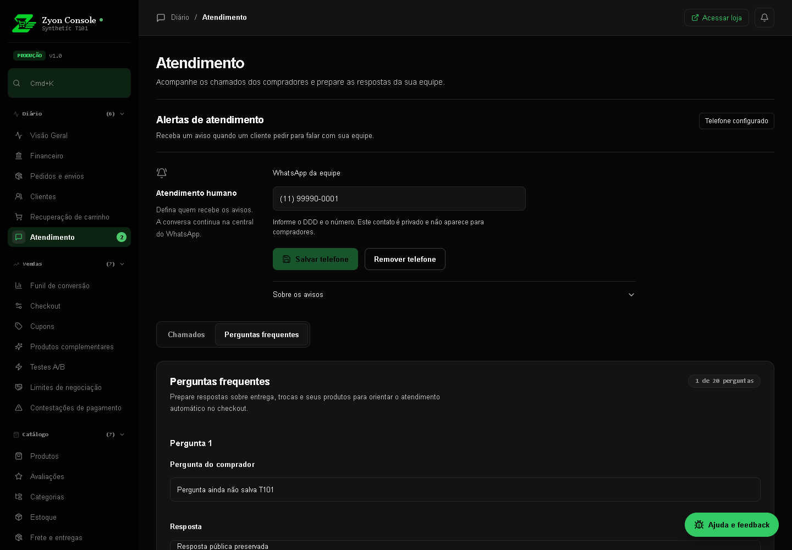
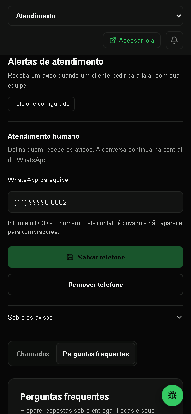
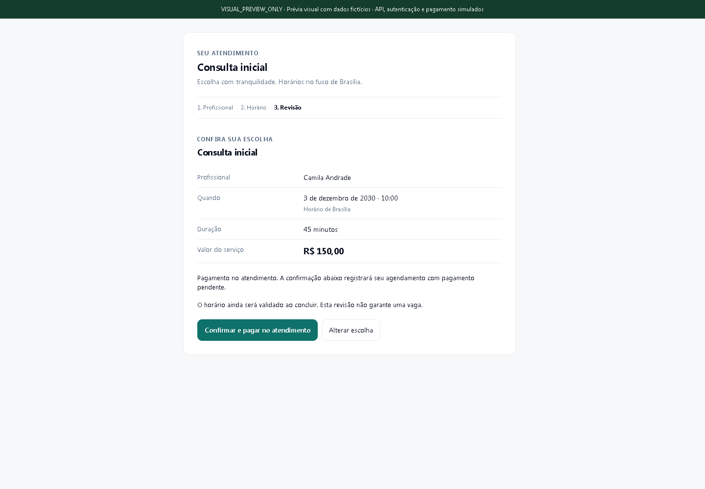
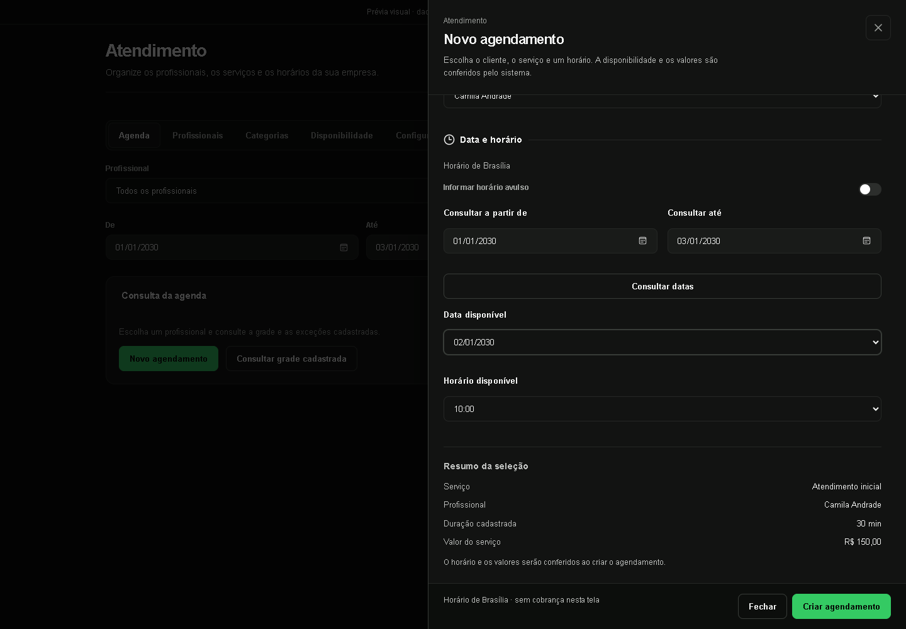
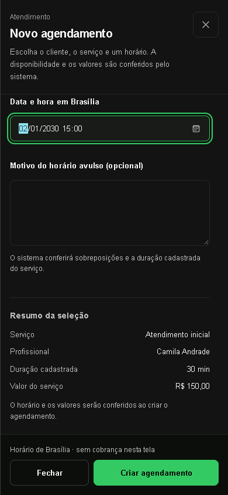

# WhatsApp Service Booking and Business RAG Specification

**User-directed public service browsing refinement (2026-11-24):** user: "nao tem nada haver isso de se identificar para ver os profissionais e horarios isso e um erro torna burocratico nao quero isso". Services, published professionals, dates and slots are browsable without buyer identification, login, OTP or buyer JWT. Ask for identification or missing registration data only when the buyer proceeds to confirmation/reservation or payment that needs it. Public reads retain trusted merchant/origin/conversation scope, canonical publication/availability/version checks and private-data boundaries. They create no buyer identity, booking hold, appointment or payment. Buyer writes retain verified identity and final capacity/financial authority; product journeys are unchanged. This direct instruction authorizes corresponding behavior/test expectation changes without another approval question. Earlier auth-before-browse evidence is historical for the revised behavior; no new criterion/task or release approval is implied.

**Approved test expectation (2026-11-22):** user: "Aprovar somente essa expectativa (recomendado)" (call_2aff476537a5480eb6f3aa13e73b084c). Only T43 strict provider required-field expectation appends serviceAction; patch0e13db86 applied once in Root. All existing cases and other assertions remain unchanged; P proposal stays historical. Receipt .cache/t43-approved-schema-test-20261122/receipt.json.

**Approved T103 presentation only, 2026-11-22:** user: "Aprovar lista e Kanban" (call_4108c87ec07e416784508e1be5124ab6). Approval covers the shown refined desktop/mobile list and Kanban from visual-only synthetic preview35b3cb9a. T103 route/detail/actions, actual authenticated API/SQL/browser proof, compilation and final verification remain required. It does not authorize publication or certify task completion.

**Approved test-only corrections, 2026-11-21:** user: "Aprovar os dois ajustes de testes" (call_b75f49875df344cda177e28c2c0ff07c), limited to T41 c074d924 and T1129d268fdd. Existing tenant isolation and original-lease rejection remain enforced; all cases and other assertions preserved. No API or requirement changes.

**Approved T81 visual only, 2026-11-21:** user: "Aprovar o visual" (call_aacdd232c6864cf0b1ef1195e36b0ffd). Approval covers the shown desktop/mobile payment-control and slot-reservation layout, captured from real T81 components with a synthetic VM in preview receipt88577ce9. It does not approve API/SQL/authentication/payment execution, a production release or completion of remaining gates. Off remains at-attendance balance, on remains online checkout.

**Approved test-only oracle corrections, 2026-11-21:** user: "Aprovar os dois patches de testes" (call_0fa5c41963424f779bdfaa4690d840ad), with overlapping T40-only grant "Corrigir somente essa asserção" (call_370e553662004bafa083495d04f0be85). Only patches1dbb0ac7 (response fields409/code/action) and dac62bc4 (T81 fixture session plus existing/me URL) were applied once. No requirement, API behavior, test count, negative case or broader approval changed. Receipt3963cf08; new Root T40 freeze662e3e3c and T81 freezea96c4040 require current affected-file verification.

**Settled ONB-03 / payment UI refinement, 2026-11-21:** user: "agendar sem cobrar e registrar valor para pagar no atendimento"; new service businesses: "Sim, começar desligado" (call_3496d7a8dc2c4819bfa1ab35a5c5a4db). The explicit online-collection toggle maps off to existing `at_attendance`, on to `online`. Off confirms the appointment without buyer checkout/online charge and retains the amount payable at attendance. New drafts start off; existing configured businesses retain their policy. This is not a free service and introduces no new payment mode. The earlier pending payment questions are resolved. Hold choices, product commerce, policy version checks and trusted historical/in-flight terms remain unchanged.

**Additional scope under clarification, 2026-11-21:** the user requests an explicit service-payment enable/disable control and scheduling without checkout when disabled (call_f18e1cec04a04cd4bf91bdb0b56aa2b6). Whether disabled means no financial obligation or a balance payable at attendance, and the initial setting for new businesses, are pending user answers. Existing payment behavior and product commerce remain preserved. Formal checks/tasks will incorporate the settled behavior before implementation.

**Settled T101 visual revision, 2026-11-21:** user: "nao recisa do ddi se baseia no layout do cashback e anuncios com ia e o novo estilo visual padrao do projeto" (call_975fea8c0c324845ac502b037785b911). The private recipient form accepts a Brazilian DDD and local number without asking for a country code. It normalizes the number to the canonical Brazilian international representation before the existing API call. The form follows the current Cashback and AI Ads visual language. Roles, tenant isolation, FAQ edits, conversation drafts and truthful delivery status remain required. The previous screenshots were not approved; revised browser captures are required.

**User-directed timezone refinement (2026-11-18):** user: "Sempre horário de Brasília, sem configuração"; "Sim, Brasília em todos os novos cadastros e agendamentos (recomendado)". AGENDA-08/ATEND-13 and T111-T113 implement fixed America/Sao_Paulo for new service records without a chooser, preserving historical zones/instants and trusted in-flight terms. Local scope84 criteria/113 tasks; original product commerce and approvals remain protected. New-write/control tests evolve under this explicit new rule; unrelated historical/security/payment/stock assertions stay intact.

**Discovered authentication prerequisite (2026-11-17):** Local source and real-hasher/JWT RED8 (3pass/5fail) reproduced password-login acceptance when verify returns valid:false. AUTH-01/T110 records the required rejection contract before service buyer authentication can be claimed. This corrects an existing security defect; no new business choice, provider action or production validation. Current scope82criteria/110tasks; original approvals remain unchanged.

**Discovered uncertain-replay repair (2026-11-17):** Actual owned SQL/incoming/Meta-adapter RED reproduced two physical local attempts after an unknown handoff notice, while legacy retained one. T109 repairs the existing HUM-03/HUM-07 contract independently from uncommitted T56, with no new criterion, product decision, timeout, provider action or oracle change. Current scope is81 criteria/109 tasks; original approvals remain unchanged. Historical close/new-handoff validation remains mandatory with T56/T57 after that capability exists.

**Approved**: 2026-11-14 - user: "Aprovar a especificação apresentada"
**Refinements approved**: 2026-11-14 - user: "Aprovar o plano e iniciar implementação local". Approval covers all 71 criteria and the 95-task plan, including later explicit refinements.
**Status:** Approved specification and refinements; tasks approved and Phase 1 implementation started locally.
**Amendment:** 2026-11-14 - user requested an About field in existing company data, a Conversations tab inside WhatsApp, a service-only Atendimento management page, manual scheduling and business-specific dashboard metrics. User also explicitly required preservation of the approved product journeys in WhatsApp and storefront. Original 47-requirement approval remains recorded above; additions are explicit for task review and have no fabricated approval date.
**Date:** 2026-11-14
**User-directed addition:** 2026-11-14 - a simple service-name list in company data, confirmed by "Lista simples em Dados da empresa (recomendado)" and "lembrando que e só para empresas de serviços". Adds ONB-06 to the original71 criteria; original approvals remain verbatim. This local addition is directly requested and does not authorize production actions.
**Size:** Complex

**User-directed catalog addition:** 2026-11-16 - user: "ah e outra coisa em cadastrar produto cadastrar serviço so aparece para empresas de serviço para empresas sem ser de serviço nao precisa mais mostrar a opção de produto de sreviço para cadastrar". Adds CAT-01/CAT-02 and T98 as directly requested local UI work, reusing the already-approved canonical exclusive business mode and T17 API guard. Current scope is74 criteria/98 tasks. Original approvals remain verbatim; no new production authority. The separately requested human-alert telephone and service Kanban are being added to the local plan.

**Human-alert channel settled:** 2026-11-16 - user: "WhatsApp, com link para a conversa (recomendado)". The configured fallback telephone receives a minimal team notification with an authenticated dashboard link. The customer stays in the original WhatsApp conversation. The private recipient is separate from public company/RAG data. No SMS integration or production send is authorized by this local implementation decision.

**User-directed support and appointments additions:** 2026-11-16 - user requested natural-language human requests, a fallback phone in support settings and a separate services-only Kanban of scheduled services replacing the primary Orders entry. HUM-02/T57 explicitly include semantic paraphrases with the existing authenticated intake authority. HUM-09/HUM-10 and ATEND-11/ATEND-12 add four criteria and T99-T103, for78 criteria/103 tasks. These are directly requested local additions; original approvals and product-preservation gates remain.

**Discovered regression repair:** 2026-11-16 - required native revalidation reproduced a Neo4j client transaction timeout during cold initial projection. T104 tests a single atomic write statement under the unchanged deadline, version lock and source-retirement contract. This is an implementation repair within RAG-01/02/03, with no added business criterion or relaxed test. Current execution count78criteria/104tasks. The hypothesis is not declared fixed until actual unchanged native gates pass.

**User-directed catalog refinement:** 2026-11-16 - user: "está sim mas trar checkbox por toggle e poder vincular um profissional a um serviço se ja nao tiver". The shown business-mode split is accepted with these two refinements. CAT-03/CAT-04 and T105/T106 reuse existing ToggleSwitch and professional-service association endpoints. Current scope is80 criteria/106 tasks; this acceptance does not approve production or the final feature.

**Discovered catalog defect:** local105 browser captures exposed an advanced-rules error while editing a Starter offer. Existing PromotionSection fetches the Growth-only endpoint without checking the same hasFeature flag already used by its UI; the API entitlement stays authoritative. CAT-05/T107 repair that inconsistency before professional-link UI, without changing plans, prices or backend guards. Current81criteria/107tasks. The new assertion records the existing feature policy, not a new business choice; exact HTTP status and final visual proof remain part of its gate.

**Runtime prerequisite repair:** T108 replaces only the repeated slow Windows native socket collector while preserving its ownership contract and10s deadline. Current81criteria/108tasks. Its30old/new guard contracts and actual Windows connection pass locally; original54API9/105browser2 remain required separately, with no production or full-feature approval.

## Problem Statement

O Zyon já vende produtos pelo WhatsApp e tem componentes de serviços, slots e suporte. A experiência ainda não comprova uma agenda com vários profissionais, atendimento humano na mesma conversa e conhecimento alimentado automaticamente pelo cadastro da empresa. A validação de comércio não comprova prontidão para atendimento de clínicas ou outros prestadores de serviços.

## Goals

- [ ] Configurar uma empresa como vendedora exclusiva de produtos ou serviços desde o signup.
- [ ] Concluir agendamento por texto ou voz, escolhendo profissional, data e horário reais.
- [ ] Aplicar a política de bloqueio e pagamento configurada pela empresa, sem duplicar vagas ou pagamentos.
- [ ] Operar atendimento humano pelo módulo WhatsApp, com pausa e retomada persistidas da IA.
- [ ] Alimentar um RAG genérico com os dados públicos cadastrados e medir respostas por fontes e resultados verificáveis.
- [ ] Gerenciar profissionais, categorias, disponibilidade e agendamentos manuais em Atendimento, exclusivo para empresas de serviços.
- [ ] Exibir KPIs de serviço com estados operacionais e financeiros separados, preservando o painel de empresas de produtos.

## Out of Scope

| Feature | Reason |
| --- | --- |
| Empresa vender produtos e serviços simultaneamente | Usuário escolheu modalidade exclusiva. |
| Agenda externa, Google Calendar ou prontuário eletrônico | Usuário escolheu agenda interna do Zyon. |
| Cancelamento/remarcação automáticos pelo comprador | Piloto usa a central humana e a política publicada. |
| Diagnóstico, prescrição e decisão autônoma de tratamento | O atendimento informativo não substitui atuação profissional. |
| Prontuários, exames e conversas privadas como corpus público | O RAG público usa informações públicas do negócio. |
| Central separada para editar conhecimento do RAG | O usuário determinou uso dos cadastros normais da empresa. |
| Publicação desta feature ou criação de cadastros clínicos em produção | Requer ação remota explicitamente autorizada, após a implementação aprovada e verificada. |
| Alterar os pedidos pagos e o estoque existentes da Athom | A validação deve preservar o estado real atual. |

## Assumptions & Open Questions

| Assumption / decision | Chosen default | Rationale | Confirmed? |
| --- | --- | --- | --- |
| Modalidade comercial | Produtos ou serviços, exclusivamente | User: "Escolha exclusiva: produtos ou serviços" | y |
| Agenda | Interna, com vários profissionais | User: "Vários profissionais com agenda interna do Zyon" | y |
| Reserva temporária e pagamento | Configurados pela própria empresa | User: "configura tempo de bloqueio se bloqueia ou nao se pagamento sera automatizado ou na hora" | y |
| Sem bloqueio | Desativa somente reserva provisória; confirmado ocupa a vaga | User: "Sem bloqueio temporário; agendamento confirmado ocupa a vaga (recomendado)" | y |
| Cancelar/remarcar | Atendimento humano conforme política cadastrada | User escolheu "opção 1" para solicitação à central humana | y |
| Central | Dentro do módulo WhatsApp, na mesma conversa, com IA pausada | User: "devemos criar essa central no modulo de whatsapp" | y |
| Retorno da IA | Automático ao encerrar o atendimento humano | User: "Automaticamente quando o humano encerrar" | y |
| RAG | Genérico, alimentado pelo cadastro e pelas alterações da empresa | User: "todo cadastro vai gerando dados para o rag e alimentando" | y |
| Campo de apresentação | "Sobre a empresa" em Dados da empresa | Solicitação explícita do usuário; reaproveitar armazenamento canônico existente | y |
| Conversas humanas | Aba dentro de WhatsApp | User: "uma tab dentro de whatsapp ja e o suficiente" | y |
| Gestão de serviços | Nova página Atendimento somente para serviços | User: "pagina nova de atendimento mas so para emrpesas que vendem serviços" | y |
| Dashboard | KPIs ajustados à modalidade | User: "kpis e metricas do dashboard devem se ajustar para este tipo de negocio" | y |
| Isolamento técnico | Reaproveitar autenticação, tenant, inbox, pagamentos e fontes canônicas existentes | Padrão do repositório; a feature não concede acesso por texto do usuário | y |
| Dados para teste | Fatos e identidades sintéticos rotulados; nenhum paciente real | Permite testes locais sem criar oferta clínica real na Athom | y |

**Open questions:** none for specification review. Cadastros, conteúdo aprovado e política real de cada empresa são insumos de ativação, não respostas inventadas pelo sistema.

## User Stories

### P1: Business capability and onboarding

**User Story:** Como empresa, quero informar o que vendo e configurar meu atendimento para mostrar somente os recursos aplicáveis ao meu negócio.

**Acceptance Criteria:**

1. WHEN a empresa conclui o signup THEN the system SHALL persistir exatamente uma modalidade comercial, `products` ou `services`, selecionada em "O que sua empresa vende?". [ONB-01]
2. WHILE a modalidade é `products` the system SHALL ocultar as ações de agendamento e recusar tentativas de executá-las pela API, preservando a navegação atual de produtos. [ONB-02]
3. WHEN uma empresa de serviços configura atendimento THEN the system SHALL exigir a escolha explícita de bloqueio temporário, duração positiva em minutos quando habilitado, e pagamento `online` ou `at_attendance`. [ONB-03]
4. IF uma troca de modalidade conflita com ofertas ativas ou agendamentos existentes THEN the system SHALL recusar a troca com a indicação do conflito, sem excluir nem converter registros. [ONB-04]
5. WHEN a empresa edita Dados da empresa THEN the system SHALL permitir salvar e reabrir o campo "Sobre a empresa" usando a descrição pública canônica, sem duplicar seu armazenamento. [ONB-05]

**Independent Test:** Signup em cada modalidade; leitura após novo login; tentativa direta de agendar em empresa de produtos; configuração inválida; troca de modalidade com registros ativos.

### P1: Professionals, dates and slots

**User Story:** Como comprador, quero escolher um profissional e ver datas e horários disponíveis para reservar o serviço certo.

**Acceptance Criteria:**

1. WHEN a empresa publica um serviço agendável THEN the system SHALL vincular sua duração e profissionais a recursos de agenda da própria empresa. [AGENDA-01]
2. WHEN a buyer opens a published service without identifying THEN the system SHALL show the published professionals and current available dates for that merchant, service and chosen professional without requesting login, OTP or buyer identity. [AGENDA-02]
3. WHEN an unidentified buyer chooses a date THEN the system SHALL show only that date’s currently available slots, with start, duration and appointment timezone, without requesting buyer identification. [AGENDA-03]
4. WHEN a buyer chooses a slot THEN the system SHALL revalidate and display service, professional, date, time and canonical price before confirmation without requiring identification for this read-only review; verified identity or missing registration data is requested only when starting the booking/reservation/payment write. [AGENDA-04]
5. IF dois serviços do mesmo profissional disputam intervalos sobrepostos THEN the system SHALL permitir no máximo um agendamento confirmado nesse intervalo. [AGENDA-05]
6. IF a agenda está vazia, desatualizada ou indisponível THEN the system SHALL informar o estado correspondente sem criar horário ou declarar indisponibilidade total a partir de uma falha de leitura. [AGENDA-06]
7. WHEN texto ou áudio descreve uma data ou profissional ambíguo THEN the system SHALL pedir a escolha explícita entre as opções atuais antes de reservar ou cobrar. [AGENDA-07]
8. WHEN a new service professional, grade, interval or appointment is created THEN the system SHALL use America/Sao_Paulo, fill an omitted zone and reject a different supplied new zone without writes, while preserving historical zones/absolute instants and proven in-flight contractual terms. [AGENDA-08]

**Public read boundary:** Anonymous discovery returns only the published offer/professional projection and bounded canonical availability. Foreign tenant, unpublished/inactive offer or professional, invalid window and stale version remain rejected. Public browsing must not create a synthetic authenticated buyer or a checkout/hold/appointment/payment. Confirmation and payment retain the original verified buyer, idempotency, policy, capacity and financial guards.

**Independent Test:** Dois profissionais, três serviços e duas datas; serviços diferentes com o mesmo profissional; competição concorrente pelo mesmo intervalo; slot vencido; leitura com erro; áudio ambíguo.

### P1: Booking and payment policies

**User Story:** Como empresa, quero controlar reserva provisória e recebimento sem permitir inconsistência entre agenda, pedido e pagamento.

**Acceptance Criteria:**

1. WHERE bloqueio temporário está habilitado the system SHALL reservar provisoriamente o intervalo pelo tempo configurado, exibindo seu vencimento pelo relógio do servidor. [BOOK-01]
2. WHEN uma reserva provisória vence ou é abandonada THEN the system SHALL liberar somente o bloqueio provisório correspondente, sem liberar um agendamento já confirmado. [BOOK-02]
3. WHERE bloqueio temporário está desabilitado the system SHALL revalidar a capacidade no ato da confirmação, sem garantir a vaga durante a seleção. [BOOK-03]
4. WHERE pagamento é `at_attendance` the system SHALL confirmar o agendamento atomicamente com a ocupação do horário e registrar pagamento pendente, sem criar cobrança antecipada. [BOOK-04]
5. WHERE pagamento é `online` the system SHALL confirmar o agendamento somente após a confirmação financeira do provedor e a aquisição válida da vaga. [BOOK-05]
6. IF pagamento é aprovado após a vaga se tornar indisponível THEN the system SHALL manter o pagamento real registrado e sinalizar regularização para a empresa, sem confirmar vaga inexistente nem cobrar novamente. [BOOK-06]
7. WHEN a empresa registra recebimento no atendimento THEN the system SHALL guardar valor, forma, operador e momento da quitação, sem apresentar esse registro como confirmação de um provedor externo. O valor registrado deve quitar exatamente o saldo pendente calculado pelo servidor; recebimentos parciais e valores acima do saldo são rejeitados. [BOOK-07]
8. IF mensagem, confirmação ou webhook é repetido THEN the system SHALL manter um único agendamento e uma única aplicação do mesmo evento financeiro. [BOOK-08]
9. WHEN o comprador solicita cancelar ou remarcar THEN the system SHALL encaminhar à central humana com o vínculo do agendamento e a política publicada da empresa. [BOOK-09]
10. WHEN uma reserva de serviço é concluída THEN the system SHALL emitir confirmação com serviço, profissional, data, hora, fuso e situação financeira, sem tratá-la como produto enviado ou baixar estoque físico. [BOOK-10]

**Independent Test:** Quatro combinações de bloqueio/pagamento; expiração por relógio controlado; duas confirmações concorrentes; pagamento tardio; webhook repetido; quitação local auditada; evento de confirmação e ausência de saída de estoque físico.

### P1: WhatsApp human support center

**User Story:** Como comprador, quero pedir um atendente na mesma conversa; como empresa, quero assumir, responder e encerrar pelo módulo WhatsApp.

**Acceptance Criteria:**

1. WHEN o comprador abre o Menu principal THEN the system SHALL apresentar a opção "Falar com atendente" sem ultrapassar o limite de opções de cada controle nativo. [HUM-01]
2. WHEN o comprador pede atendente por botão, texto ou voz, inclusive durante o checkout, THEN the system SHALL abrir ou reutilizar um atendimento vinculado à empresa e conversa autenticadas antes de confirmar o encaminhamento. [HUM-02]
3. WHILE o atendimento está aguardando ou sob atendimento humano the system SHALL pausar as respostas automáticas da IA sem perder carrinho, agendamento ou pagamento. [HUM-03]
4. WHEN operador autorizado acessa a central do módulo WhatsApp THEN the system SHALL permitir consultar a fila, assumir uma conversa, responder e encerrar somente atendimentos de sua empresa. [HUM-04]
5. WHEN operador envia resposta THEN the system SHALL persistir a mensagem e seu estado de entrega na conversa original, sem considerar aceite do provedor como leitura pelo comprador. [HUM-05]
6. WHEN operador encerra o atendimento THEN the system SHALL restaurar o modo IA e informar a devolução uma única vez, mesmo com eventos repetidos. [HUM-06]
7. IF a fila, a entrega ou a equipe está indisponível THEN the system SHALL informar o estado real, sem prometer atendimento imediato ou resposta já enviada. [HUM-07]
8. WHEN o operador abre o módulo WhatsApp THEN the system SHALL oferecer a aba "Conversas" para operar o atendimento humano existente sem exigir uma central separada para o RAG. [HUM-08]

**Independent Test:** Pedido durante coleta de dados; fila e tomada de conversa; resposta real na mesma thread; operador de outro tenant negado; fechamento duplicado; geração de IA em andamento ao iniciar handoff.

### P1: Automatic generic business RAG

**User Story:** Como empresa de qualquer ramo de serviços, quero que meus cadastros publicados alimentem o conhecimento do assistente sem manutenção manual de seeds.

**Acceptance Criteria:**

1. WHEN cadastro público da empresa, profissional, serviço, horário de funcionamento, FAQ ou política é publicado ou alterado THEN the system SHALL registrar atualização idempotente da projeção de conhecimento com tenant, origem e versão. [RAG-01]
2. WHEN uma fonte é retirada ou despublicada THEN the system SHALL impedir seu uso como evidência ativa e retirar sua projeção, sem recuperar texto antigo como resposta atual. [RAG-02]
3. IF embeddings ou grafo estão indisponíveis THEN the system SHALL conservar o cadastro canônico e registrar a indexação pendente para nova tentativa, sem desfazer o cadastro nem inventar uma resposta. [RAG-03]
4. WHEN o assistente compõe uma resposta factual THEN the system SHALL usar fontes públicas da empresa autenticada e conservar as referências de origem e versão para auditoria. [RAG-04]
5. WHEN a pergunta combina área de atuação, serviço, profissional, preço e disponibilidade THEN the system SHALL combinar recuperação semântica com leituras canônicas de serviço, preço e agenda, sem extrair confirmação financeira ou vaga de um embedding. [RAG-05]
6. IF não há fonte suficiente ou há conflito entre fontes THEN the system SHALL explicitar a lacuna e pedir esclarecimento ou encaminhar ao humano, sem atribuir à empresa um serviço, credencial ou política não publicada. [RAG-06]
7. The system SHALL excluir credenciais, prontuários, dados pessoais privados e conversas de clientes do corpus público e das respostas a outros compradores. [RAG-07]
8. WHILE a recuperação usa Neo4j Community the system SHALL executar somente consultas parametrizadas e aprovadas no gateway privado, sem executar Cypher livre fornecido pelo modelo ou comprador. [RAG-08]
9. WHEN um cenário de segmento regulado exige diagnóstico, prescrição ou decisão profissional individual THEN the system SHALL encaminhar ao profissional e limitar a resposta informativa ao conteúdo publicado aplicável. [RAG-09]
10. WHEN uma nova empresa de um ramo de serviços é cadastrada THEN the system SHALL aplicar o mesmo fluxo de ingestão e consulta sem FAQ, nomes ou especialidades médicos hardcoded. [RAG-10]
11. WHEN a empresa mantém apresentação, políticas, profissionais e horários em seus cadastros normais THEN the system SHALL alimentar o contexto desses registros sem exigir duplicação de conteúdo em uma central de RAG. [RAG-11]

**Independent Test:** Neurologia, salão e consultoria com conteúdo sintético; atualizações e remoções; contradições; falha de grafo; fonte de outro tenant; dados privados; prompt injection; consultas compostas com agenda operacional.

### P1: Service management page

**User Story:** Como empresa de serviços, quero organizar minha equipe, categorias e agenda e registrar agendamentos manuais no mesmo domínio usado pelo comprador.

**Acceptance Criteria:**

1. WHEN uma empresa de serviços abre a navegação administrativa THEN the system SHALL oferecer a página "Atendimento", negando sua gestão a empresas de produtos também nas rotas da API. [ATEND-01]
2. WHEN operador autorizado mantém profissionais THEN the system SHALL permitir cadastrar, editar e desativar profissionais da própria empresa, preservando o histórico de agendamentos. [ATEND-02]
3. WHEN operador mantém categorias de atendimento THEN the system SHALL vincular categorias e serviços publicados sem transformar categoria em recurso de capacidade. [ATEND-03]
4. WHEN a empresa publica disponibilidade de um profissional THEN the system SHALL considerar grade, duração do serviço, fuso e indisponibilidades na mesma leitura usada pelo WhatsApp, storefront e agendamento manual. [ATEND-04]
5. WHEN operador cria um horário avulso THEN the system SHALL validá-lo no fuso do profissional e impedir sobreposição com intervalos confirmados ou bloqueados. [ATEND-05]
6. WHEN operador cria um agendamento manual THEN the system SHALL aplicar a mesma capacidade, política financeira, identidade de cliente e idempotência usadas no fluxo de autoatendimento. [ATEND-06]
7. WHEN operador inicia, conclui ou registra ausência de um atendimento THEN the system SHALL persistir a transição operacional explícita sem inferir quitação financeira ou comparecimento pelo pagamento. [ATEND-07]
8. IF um operador tenta gerir profissional, categoria, grade ou agendamento de outra empresa THEN the system SHALL recusar a operação sem expor o registro solicitado. [ATEND-08]
9. WHEN operador bloqueia uma indisponibilidade THEN the system SHALL retirar o intervalo da oferta pública sem cancelar ou sobrepor silenciosamente agendamentos confirmados. [ATEND-09]
10. WHEN operador agenda fora da grade regular THEN the system SHALL permitir a criação explícita de horário avulso na mesma operação, sem sobreposição e sob a política de pagamento vigente. [ATEND-10]

**Independent Test:** Cadastro e desativação de profissional com histórico; categoria com serviços; mesma agenda nos três canais; agendamento manual em disputa com comprador; ações operacionais com pagamento local pendente; acesso de outro tenant.

### P1: Service dashboard metrics

**User Story:** Como empresa de serviços, quero ver minha operação e meus recebimentos por indicadores adequados, sem confundir agendamento com venda paga ou atendimento realizado.

**Acceptance Criteria:**

1. WHEN a empresa abre o dashboard THEN the system SHALL selecionar os indicadores da modalidade comercial persistida, mantendo os indicadores atuais para produtos. [KPI-01]
2. WHEN o painel contabiliza agendamentos do período THEN the system SHALL contar cada agendamento uma vez por estado operacional, usando o início agendado no fuso da empresa como coorte declarada. [KPI-02]
3. WHEN o painel calcula ocupação THEN the system SHALL dividir minutos ocupados confirmados pelos minutos ofertados únicos por profissional no período, sem duplicar capacidade de serviços que compartilham esse profissional. [KPI-03]
4. WHEN o painel mostra valores de serviços THEN the system SHALL separar valor agendado, valor a receber e valor dos serviços efetivamente pagos, excluindo taxas adicionais cobradas do comprador e usando evidência financeira online ou local deduplicada. [KPI-04]
5. WHEN operador filtra período, profissional ou categoria THEN the system SHALL aplicar os mesmos limites de tenant e período aos totais e detalhamentos retornados pela API. [KPI-05]
6. WHEN o painel mostra concluídos ou ausências THEN the system SHALL usar somente os estados operacionais registrados, sem inferir conclusão por pagamento ou ausência pelo decurso do horário. [KPI-06]
7. IF uma leitura de métricas falha ou o denominador de uma taxa não existe THEN the system SHALL distinguir dados indisponíveis de zero e mostrar taxa não calculável sem fabricar percentuais. [KPI-07]

**Independent Test:** Agenda sintética conhecida com dois profissionais, serviços compartilhados, cancelamentos, ausência, concluídos não pagos e pagamentos sem comparecimento; fronteira de fuso; filtros; indisponibilidade; painel de produtos inalterado.

### P1: Preserve approved product journeys

**User Story:** Como empresa de produtos, quero continuar usando os fluxos já aprovados enquanto empresas de serviços recebem uma jornada própria.

**Acceptance Criteria:**

1. WHEN uma empresa usa WhatsApp ou storefront THEN the system SHALL selecionar a jornada pela modalidade canônica da empresa, sem aplicar políticas de agenda, pagamento no atendimento ou controles de profissional à compra de produtos. [REG-01]
2. WHEN a nova jornada de serviços é validada THEN the system SHALL comprovar nos dois canais a preservação de catálogo, busca e comparação, detalhes e avaliações, carrinho e cross-sell, identidade e endereço, frete e checkout, incluindo Pix, cartão e troca do método de pagamento de produtos. [REG-02]
3. WHEN pagamentos de produtos e agendamentos de serviços são processados na mesma revisão THEN the system SHALL preservar totais, recibos, transições de pedido, eventos e baixa de estoque físico de produtos, impedindo que eventos de serviço produzam envio ou saída de estoque físico. [REG-03]
4. WHEN a feature é migrada, habilitada ou desabilitada THEN the system SHALL preservar empresas e registros existentes, manter serviços novos desabilitados para empresas de produtos e conservar o processamento dos agendamentos e pagamentos já iniciados. [REG-04]

**Independent Test:** Dois tenants sintéticos, um de cada modalidade, no WhatsApp e storefront; matriz de comércio aprovada antes/depois; migração sobre fixture de dados anteriores; desativação de novas reservas com pagamentos pendentes e agendamentos confirmados preservados.

### P1: Private human-support alerts

**User Story:** Como empresa, quero receber um aviso de pedido de atendimento humano no WhatsApp da equipe, mantendo o cliente na conversa original.

**Acceptance Criteria:**

1. WHEN um operador autorizado configura ou remove o telefone de fallback em Atendimento/Suporte THEN the system SHALL persistir um destinatário privado da própria empresa, independente da modalidade, sem publicá-lo no storefront/RAG nem modificar o conteúdo ou a versão pública do FAQ. [HUM-09]
2. WHEN um novo atendimento humano é confirmado com telefone de fallback configurado THEN the system SHALL enfileirar uma única notificação de WhatsApp por atendimento/época com link autenticado para a conversa, mantendo o cliente no canal original e expondo falha ou resultado incerto sem afirmar entrega nem duplicar envio incerto. [HUM-10]

**Independent Test:** Salvar e limpar telefone pela UI/API; comparar FAQ e fontes públicas antes/depois; pedido humano por texto/voz/tool gera um atendimento e um alerta; rollback, duplicação, indisponibilidade e resultado incerto mantêm os estados verdadeiros. O transporte de teste é local.

### P1: Service appointments board

**User Story:** Como prestador de serviços, quero acompanhar os agendamentos em Kanban ou lista sem misturá-los com pedidos de produtos ou configurações da agenda.

**Acceptance Criteria:**

1. WHEN um operador autorizado abre Agendamentos THEN the system SHALL oferecer Kanban e lista da mesma consulta canônica de ServiceAppointment, com os seis estados operacionais, filtros coerentes de período/profissional/serviço e estado financeiro separado, preservando versão e registro anterior quando uma ação falha. [ATEND-11]
2. WHEN uma empresa de serviços acessa a navegação principal THEN the system SHALL apresentar Agendamentos no lugar da entrada principal de Pedidos e conservar Atendimento para gestão, enquanto empresas de produtos preservam Pedidos e não acessam Agendamentos por menu ou URL, sem apagar o histórico de pedidos de qualquer modalidade. [ATEND-12]
3. WHEN a service company creates a new professional, grade, interval or appointment through the interfaces THEN the system SHALL show Brasilia without an editable timezone and submit canonical server selection, retaining historical zone facts read-only. [ATEND-13]

**Independent Test:** Mesmos IDs/contagem nos dois modos de visualização, seis estados e pagamentos separados, filtros/fuso, ações permitidas e conflito versionado, navegação/URL nas duas modalidades, histórico preservado e capturas locais desktop/mobile.

### P1: Catalog creation matches the selected business mode

**User story:** A empresa encontra o cadastro correspondente à modalidade que escolheu, com os mesmos controles visuais e a autoridade de catálogo existentes.

1. WHILE a modalidade canônica da empresa é `products`, WHEN o operador abre o cadastro THEN the system SHALL oferecer apenas os tipos `physical`, `digital` e `food`, sem a opção de cadastrar `service`, preservando a validação da API e os registros históricos. [CAT-01]
2. WHILE a modalidade canônica da empresa é `services`, WHEN o operador abre ou limpa o cadastro THEN the system SHALL apresentar o fluxo "Novo serviço" com tipo `service`, conservando esse tipo no envio e sem converter silenciosamente um registro já carregado de outra modalidade. [CAT-02]
3. WHEN o operador altera uma configuração booleana no cadastro de produto ou serviço THEN the system SHALL apresentar um toggle acessível com nome e estado, conservando o valor, validação e persistência existentes. [CAT-03]
4. WHILE a modalidade canônica é `services`, WHEN o operador vincula profissionais a um serviço salvo THEN the system SHALL permitir selecionar profissionais da própria empresa, preservar os outros serviços de cada profissional e apresentar conflitos ou falhas sem duplicar o serviço nem declarar vínculos não persistidos. [CAT-04]
5. WHERE o plano atual não habilita regras avançadas, WHEN o operador abre o cadastro salvo THEN the system SHALL manter o bloqueio visual existente e não consultar regras avançadas, conservando o acesso e o carregamento para planos habilitados sem aplicar respostas antigas após mudança de contexto. [CAT-05]

**Independent Test:** Abrir o catálogo com empresas sintéticas de produtos e serviços; clicar no cadastro; verificar opções, padrão/reset e payload; alternar contexto durante edição; demonstrar que tipos inválidos continuam recusados pela guarda existente. Capturar as duas modalidades no navegador local em desktop/mobile. Esses testes não alteram os fluxos de compra existentes.

### P1: Evidence and acceptance

**User Story:** Como responsável pelo produto, quero comprovar UI, reservas, pagamentos e conhecimento antes de liberar uma empresa real.

**Acceptance Criteria:**

1. WHEN a feature é validada THEN the system SHALL produzir uma matriz que relacione cada critério ao comando e à evidência de seu resultado no mesmo HEAD. [QA-01]
2. WHEN o fluxo visual é demonstrado THEN the system SHALL fornecer prints das telas e conversas correspondentes, marcando separadamente prévias locais e capturas reais. [QA-02] Sources: captures/t101-approved-national-desktop.png, captures/t101-approved-national-mobile.png, captures/t45-approved-desktop-review.png, captures/t45-approved-mobile-confirmed.png, captures/t79-approved-desktop-regular-summary.png, captures/t79-approved-mobile-oneoff-summary.png.
3. WHEN os testes financeiros e de concorrência são executados THEN the system SHALL comprovar unicidade de reserva, estado financeiro verdadeiro e isolamento de tenant, sem depender apenas da mensagem da IA. [QA-03]
4. WHEN o RAG é avaliado THEN the system SHALL medir respostas apoiadas por fonte, tratamento de ausência/contradição e uso correto de ferramentas em três ramos, exigindo aprovação de todos os casos críticos antes da ativação. [QA-04]

**Independent Test:** Relatório de provas, mutações independentes, revisão de telas e UAT por texto/voz no WhatsApp e storefront, com revisão profissional do corpus quando aplicável.

### P0: Verified buyer login prerequisite

**User Story:** Como comprador, quero que somente a senha correta permita acessar meus dados e agendamentos.

**Acceptance Criteria:**

1. IF buyer password verification returns valid:false THEN the system SHALL reject login with HTTP401 invalid_credentials, issue no buyer credential and preserve the account, while accepting the correct password through the existing authenticated buyer guard. [AUTH-01]

**Independent Test:** Real PasswordHasher and JWT signer; wrong password, malformed hashes, absent and phone-only accounts; correct normalized email and password; forged JWT; actual local HTTP/SQL and unchanged product journeys.

## Edge Cases

- IF um ID de profissional, empresa ou horário pertence a outro tenant THEN the system SHALL rejeitar a ação sem expor dados desse tenant. [EDGE-01]
- IF uma política muda durante uma reserva THEN the system SHALL exigir uma nova confirmação da condição comercial atual antes de criar cobrança ou reserva final. [EDGE-02]
- IF a mídia de confirmação falha THEN the system SHALL preservar a entrega do texto e o estado canônico já confirmado. [EDGE-03]
- IF um operador assume enquanto uma resposta da IA está em processamento THEN the system SHALL impedir o envio dessa resposta automática após a mudança de modo. [EDGE-04]
- IF a fonte contém instruções para executar ferramentas ou revelar dados THEN the system SHALL tratá-la somente como conteúdo recuperado, sem conceder autoridade operacional. [EDGE-05]

### P1: Public service names in company data

**User Story:** Como empresa de serviços, quero cadastrar uma lista simples do que ofereço em Dados da empresa para apresentar meu negócio e dar contexto ao assistente.

**Acceptance Criteria:**

1. WHILE a modalidade canônica é `services` the system SHALL permitir adicionar pelo botão "+", editar, remover, salvar e reabrir uma lista de nomes de serviços em Dados da empresa e usar somente os nomes públicos salvos como contexto do RAG, ocultando e recusando sua edição para empresas de produtos e retirando esse contexto quando a modalidade mudar para produtos. [ONB-06]

**Independent Test:** Na empresa de serviços adicionar dois nomes, editar/remover, salvar e recarregar com persistência real; provar os nomes na fonte pública atual, omissão preservando dados e lista vazia limpando contexto. Na empresa de produtos não mostrar o controle, recusar escrita direta e impedir uso de nomes históricos pelo RAG. A lista não cria preço, duração, disponibilidade ou oferta comercial.

## Requirement Traceability

| Requirement ID | Story | Tasks | Status |
| --- | --- | --- | --- |
| ONB-01 | Capability selection | T4, T8, T9, T10 | Implemented locally |
| ONB-02 | Conditional navigation and API | T7, T9, T10, T17, T19, T94 | In Progress (T17 and T19 complete) |
| ONB-03 | Merchant appointment policy | T4, T7, T11, T27, T81 | In Progress (T4, T7, T11 and T27 complete) |
| ONB-04 | Non-destructive mode change | T5, T7, T12, T17 | In Progress (T17 complete) |
| ONB-05 | About field in company data | T13, T14, T15, T16 | Implemented locally |
| ONB-06 | Service-name list in company data, services only | T96, T97, T63, T72 | Complete locally (T96/T97/T63/T72); final feature proof pending |
| AGENDA-01 | Professional resources | T4, T18, T20, T21, T76, T106 | In Progress (T18, T20 and T21 complete) |
| AGENDA-02 | Dates | T23, T24, T43, T44, T45 | In Progress (T23 and T24 complete); T43 canonical tools complete locally63, remaining tasks/final proof pending |
| AGENDA-03 | Slots | T23, T24, T43, T44, T45 | In Progress (T23 and T24 complete); T43 canonical tools complete locally63, remaining tasks/final proof pending |
| AGENDA-04 | Selection summary | T28, T40, T42, T43, T45, T46 | In Progress (T28/T40 selection and authenticated preparation complete; T42 local selection/ambiguity full53 complete; T43/T45/T46 channel pickers and final criterion proof pending); T43 canonical tools complete locally63, remaining tasks/final proof pending |
| AGENDA-05 | Shared capacity | T23, T26, T34, T35 | Implemented locally (all current canonical/legacy writers share authority; final feature proof pending) |
| AGENDA-06 | Empty/error states | T23, T24, T44 | In Progress (T23 and T24 complete) |
| AGENDA-07 | Text/voice ambiguity | T42, T46, T93 | In Progress (T42 local text/voice ambiguity and canonical channel full53 complete; T46/T93 and final criterion proof pending) |
| AGENDA-08 | Fixed new service timezone and trusted history | T111, T112, T113 | Pending; explicit user decision2026-11-18 |
| BOOK-01 | Provisional hold | T27 | Implemented (T27; final proof pending) |
| BOOK-02 | Expiry | T27 | Implemented (T27; final proof pending) |
| BOOK-03 | No provisional hold | T26, T27, T28, T29, T40 | Implemented locally (T26/T27/T28/T29/T40 complete; finalfeatureproof pending) |
| BOOK-04 | Pay at attendance | T30, T40, T46 | In Progress (T30/T40 atomicpay-at-attendance complete; T46channelintegration pending) |
| BOOK-05 | Pay online | T29, T35, T40 | Implemented locally (T29/T35/T40 complete with scopedonlineadmission; finalfeatureproof pending) |
| BOOK-06 | Late payment | T36 | Complete locally at T36; Full422, actual claim/SQL/Redis and original product regressions; final feature verification pending |
| BOOK-07 | On-site receipt | T4, T37, T41, T80 | In Progress (T37/T41 canonical receipt writer and authorized HTTP/SQL complete; T80 UI and final proof pending) |
| BOOK-08 | Idempotency | T26, T30, T31, T32, T33, T34, T35, T36, T37, T38, T84 | In Progress (T26/T30/T31/T32/T33/T34/T35/T36/T37 locally complete; T38/T84 and final proof pending) |
| BOOK-09 | Change requests | T33, T34, T41, T49, T80 | In Progress (T33/T34 canonical changes and T41 authorized HTTP/SQL complete; buyer human-flow and T80 UI pending) |
| BOOK-10 | Confirmation and inventory | T35, T38, T39 | Done locally (canonical admission, outbox, formatted confirmation and stock preservation; task-39-evidence.json Full322; real provider and final sameHEAD proof pending) |
| HUM-01 | Fixed menu entry | T57 | Complete (LOCAL; T57 menu and signed gesture gated; final feature verification pending) |
| HUM-02 | Handoff intake | T49, T50, T57 | Complete (LOCAL; T49/T50/T57 intake, router and button/text/voice with canonical acknowledgement gated; final feature verification pending) |
| HUM-03 | AI pause | T4, T48, T49, T50, T51, T109 | Complete (LOCAL; T4/T48-T51 and T109 locally gated; final feature verification pending) |
| HUM-04 | WhatsApp center | T52, T53, T58, T59, T60, T61, T62 | In Progress (T52/T53/T58/T59 authority/queue, T60 hook and T61 mounted drawer locally complete; T62 actual app/tab mount and final feature verification pending) |
| HUM-05 | Original conversation delivery | T53, T54, T55, T60, T61 | Complete (LOCAL; T53-T55 canonical transport/receipts, T60 reconciliation and T61 truthful delivery/draft presentation locally gated; final integrated verification pending) |
| HUM-06 | Automatic AI resume | T56, T61 | Complete (LOCAL; T56 canonical closure/resume and T61 actual operator closure/IA return locally gated; final feature proof pending) |
| HUM-07 | Unavailable team/provider | T54, T55, T58, T109 | In Progress (T54/T55/T58/T109 server truth locally complete; final UI/feature verification pending) |
| HUM-08 | Conversations tab inside WhatsApp | T58, T59, T60, T62, T82 | In Progress (T58 scoped API/bootstrap, T59 permissions and T60 local hook complete; T62/T82 tab/route wiring pending) |
| RAG-01 | Automatic indexing | T4, T21, T63, T64, T65, T66, T104 | Implemented locally including T104 bounded-write repair; final proof pending |
| RAG-02 | Retirement | T65, T67, T68, T104 | Implemented locally including T104 bounded-write repair; final proofs pending |
| RAG-03 | Retry and source durability | T64, T66, T67, T104 | Implemented locally including T104 bounded-write repair; final proofs pending |
| RAG-04 | Source provenance | T66, T68, T69 | Implemented locally (T66/T68/T69 complete; final integrated proof pending) |
| RAG-05 | Compound live queries | T70, T71 | Complete locally at T70/T71 Full; current facts and final fence proved, final verification pending |
| RAG-06 | Insufficient/conflicting evidence | T68, T71 | Complete locally at T68/T71 Full; missing/conflicting/stale sources refuse, final verification pending |
| RAG-07 | Public/private isolation | T6, T63, T68, T69 | Implemented locally (T6/T63/T68/T69 complete; final integrated proof pending) |
| RAG-08 | Controlled Cypher | T2, T70 | Implemented locally; final integrated proof pending |
| RAG-09 | Professional boundary | T71, T72 | Complete locally (T71/T72 scripted composition and professional boundary); provider-quality and final verification pending |
| RAG-10 | Generic onboarding | T63, T67, T71, T72 | Complete locally (T63/T67/T71/T72, three-business scored fixtures); final verification pending |
| RAG-11 | Existing forms feed context | T13, T14, T15, T63, T64, T65 | Pending |
| ATEND-01 | Service-only management | T41, T47, T73, T74, T75, T82, T83 | In Progress (T41 authorized HTTP/SQL reads and established writers complete; T47/T82/T83 management composition and UI pending) |
| ATEND-02 | Professional administration | T18, T19, T76, T106 | Complete locally at their task gates; combined T78 Browser retained one unresolved pre-editor-load failure, final verification pending |
| ATEND-03 | Service categories | T20, T77 | Complete locally (canonical link reader, actual category gestures/persistence and capacity preservation); final verification pending |
| ATEND-04 | Shared availability | T21, T23, T24, T25, T78 | In Progress (T21, T23, T24 and T25 complete) |
| ATEND-05 | One-off times | T22, T25, T78 | In Progress (T22 and T25 complete) |
| ATEND-06 | Manual appointments | T31, T41, T74, T79 | In Progress (T31/T41 canonical manual HTTP/SQL complete; T79 UI and final proof pending) |
| ATEND-07 | Attendance lifecycle | T32, T41, T74, T80 | In Progress (T32/T41 explicit lifecycle HTTP/SQL complete; T80 UI gestures and final proof pending) |
| ATEND-08 | Management authorization | T6, T11, T19, T25, T41, T47, T52, T59, T73, T75, T83, T87 | In Progress (T41 owner/admin read/write HTTP and tenant isolation complete; remaining UI and metrics composition pending) |
| ATEND-09 | Unavailability blocks | T22, T25, T78 | In Progress (T22 and T25 complete) |
| ATEND-10 | Explicit outside-hours appointment | T25, T31, T79 | In Progress (T25/T31 locally complete; T79 UI pending) |
| KPI-01 | Business-specific dashboard | T82, T87, T88, T89, T90, T91 | Pending |
| KPI-02 | Appointment cohort and counts | T85, T86, T89 | Pending |
| KPI-03 | Capacity occupancy | T86, T89 | Pending |
| KPI-04 | Separate financial metrics | T37, T85, T86, T89 | In Progress (T37 immutable local financial evidence complete; aggregates/panel and final proof pending) |
| KPI-05 | Consistent filters | T85, T87, T88, T91 | Pending |
| KPI-06 | Explicit attendance evidence | T32, T85, T86, T89 | In Progress (T32 canonical operational evidence locally complete; metrics consumers/panel pending) |
| KPI-07 | Unknown and empty metrics | T86, T87, T88, T89, T91 | Pending |
| REG-01 | Separate business journeys in both channels | T7, T9, T17, T28, T43, T45, T46, T47, T62, T82, T83, T90, T91, T93 | In Progress (T17 complete); T43 canonical tools complete locally63, remaining tasks/final proof pending |
| REG-02 | Approved product interactions | T3, T17, T28, T29, T46, T57, T90, T93 | In Progress (T17 complete) |
| REG-03 | Physical commerce financial and stock integrity | T2, T29, T35, T38, T92, T93 | In Progress (T35 stock/financial/product preservation locally proved; T38/T92/T93 and final proof pending) |
| REG-04 | Compatible migration and safe activation | T1, T3, T5, T7, T8, T12, T17, T36, T47, T84, T94 | In Progress (T17/T36 locally complete; writer migration, activation and final checks pending) |
| AUTH-01 | Reject invalid buyer passwords before JWT | T110 | Complete |
| QA-01 | Criteria proofs | T1, T108, T109, T95 | Pending; native collector and replay repairs do not close final feature proof |
| CAT-01 | Product-mode creation options | T98 | Complete locally;55unit+2real browser, no skips; final screen review later |
| CAT-02 | Service-mode creation and defaults | T98 | Complete locally; defaults/reset/payload/history and actual stale-mode409 proved |
| CAT-03 | Catalog boolean toggles | T105 | Complete locally at T105 (139 components, two actual Browser cases and headers); service schedule presentation deliberately evolves under T78 |
| CAT-04 | Professional links in service editor | T106, T76 | Complete locally at T106 (188 components, eight actual Browser cases and headers); combined T78 second-page pre-editor-load failure remains unresolved |
| CAT-05 | Advanced-rules UI follows existing plan entitlement | T107 | Complete LOCAL;70components +3actual browser/nativecleanup, types/lint/build, six Root-reviewed native captures; policy unchanged |
| HUM-09 | Private support fallback recipient | T99, T101 | Implemented locally (T99/T101 private API and national phone UI complete; final feature verification pending) |
| HUM-10 | Durable staff WhatsApp case alert | T100, T101 | Implemented locally (T100/T101 durable private alert and truthful UI complete; final feature verification pending) |
| ATEND-11 | Canonical appointments Kanban/list | T41, T74, T102, T103 | In Progress (T41 authorized canonical reads and T102 coherent view model/query/SDK/hook complete locally; T103 actual board/list gestures, build and final proof pending) |
| ATEND-12 | Service-only appointments navigation | T82, T83, T103 | Pending; explicitly requested2026-11-16 |
| ATEND-13 | Fixed timezone UI without a chooser | T113 | Pending; explicit user decision2026-11-18 |
| QA-02 | Screenshots | T3, T16, T39, T44, T61, T75, T89, T93, T95 | In Progress (T61 actual local desktop/mobile drawer captures and Browser gate complete; optional visual approval unanswered, remaining task captures and final screens review pending) |
| QA-03 | Persisted state proof | T2, T5, T26, T108, T92, T95 | In Progress (T26 complete) |
| QA-04 | RAG evaluation | T72, T94, T95 | In Progress (T72 critical evaluation locally complete; T94/T95 final activation gates pending) |
| EDGE-01 | Foreign tenant identity | T6, T18, T22, T40 | Implemented locally (T6/T18/T22/T40 isolation complete; finalfeatureproof pending) |
| EDGE-02 | Changed policy | T11, T28, T30, T40, T81 | In Progress (T11/T28/T30/T40 guardedpolicy/version complete; T81settingsUI pending) |
| EDGE-03 | Optional media failure | T38, T39 | Pending |
| EDGE-04 | In-flight AI response | T48, T51, T56 | Complete locally (T48/T51/T56 and actual AI dispatch/request/commit fences); final integrated verification pending |
| EDGE-05 | Retrieved-content injection | T70, T71 | Pending |

**Coverage:** 72 identified requirements: the original approved71 plus the directly requested ONB-06 service-name list. Product refinements are recorded in context.md; original approvals remain unchanged.

## Implicit Requirement Dimensions

| Dimension | Coverage |
| --- | --- |
| Input validation and bounds | ONB-01/03, AGENDA-04/07; positive hold duration, allowed policy modes, tenant-bound canonical IDs. |
| Failure and partial failure | AGENDA-06, BOOK-06, HUM-07, RAG-03/06; no false success. |
| Idempotency and duplicate handling | BOOK-08, HUM-02/06, RAG-01; existing inbox and outbox conventions. |
| Authorization and rate limits | ONB-02, HUM-04, RAG-04/07/08; reuse authenticated tenant limits and staff permissions. |
| Concurrency and ordering | AGENDA-05, BOOK-04/05, HUM-03 and stale-generation guard. |
| Data lifecycle and expiry | BOOK-01/02, RAG-02; confirmed reservation survives provisional-hold expiry. |
| Observability | QA-01/03/04; IDs of sources/events, state changes and delivery, with private fields redacted. |
| External dependency failure | BOOK-06, HUM-05/07, RAG-03; no duplicate provider action on uncertain result. |
| State transition integrity | BOOK-02/04/05/07, HUM-03/06; booking, finance and attendance have distinct states. |

## Differences from the source

None - the product matches the source.

## Sources

- Pedido e respostas do usuário em 2026-11-14; transcrição de decisões em context.md.
- Código inspecionado: `apps/api/src/modules/catalog/domain/services/service-schedule.ts`, `apps/api/src/shared/bookings/service-slot-holds.service.ts`, `apps/api/src/shared/persistence/order-fulfillment.ts`.
- Suporte existente: `apps/api/src/modules/support/application/support-handoff.service.ts`, `send-ticket-message.use-case.ts`; navegação em `whatsapp-channel/domain/ui/buyer-hub.ts`.
- RAG atual: `apps/api/src/modules/graph-rag/application/graph-projection.service.ts`, `graph-retrieval.service.ts` e `domain/graph-query.ts`.
- Signup atual inspecionado no workspace principal: `apps/dashboard/src/lib/signup-options.ts` e `apps/api/src/modules/auth/application/register-merchant.use-case.ts`; reconciliação com a revisão publicada será uma verificação do design.
- [CFM: uso de IA como apoio e decisão profissional humana](https://portal.cfm.org.br/noticias/regras-sobre-uso-da-ia-na-medicina-entram-em-vigor-no-dia-26-de-agosto), consultado em 2026-11-14.
- [WHO: limitações e governança de modelos generativos em saúde](https://www.who.int/news/item/18-01-2024-who-releases-ai-ethics-and-governance-guidance-for-large-multi-modal-models), consultado em 2026-11-14.
- `t101-approved-national-desktop.png` ? **binding**, QA-02, T101 national DDD desktop: 
- `t101-approved-national-mobile.png` ? **binding**, QA-02, T101 national DDD mobile: 
- `t45-approved-desktop-review.png` ? **binding**, QA-02, T45 buyer appointment review desktop: 
- `t45-approved-mobile-confirmed.png` ? **binding**, QA-02, T45 buyer confirmed mobile: 
- `t79-approved-desktop-regular-summary.png` ? **binding**, QA-02, T79 regular manual appointment desktop: 
- `t79-approved-mobile-oneoff-summary.png` ? **binding**, QA-02, T79 explicit one-off summary mobile: 

## Success Criteria

- [ ] Cadastro em uma modalidade não habilita ações da outra.
- [ ] WhatsApp e storefront preservam os fluxos de produtos aprovados enquanto serviços seguem sua jornada específica.
- [ ] Profissional não recebe dois agendamentos confirmados em intervalos sobrepostos.
- [ ] Quatro combinações de bloqueio/pagamento preservam agenda e situação financeira reais.
- [ ] Atendimento humano é operado no módulo WhatsApp e a IA retoma automaticamente ao encerrar.
- [ ] Cadastros públicos de três ramos alimentam o RAG sem seeds manuais como mecanismo normal.
- [ ] Todos os casos críticos, os testes vinculados aos critérios e a verificação independente passam antes de ativação.

**T73 client wire correction approved:** 2026-11-16 - user: "Corrigir essa expectativa (recomendado)" (reply call_8c2dbee1ab4c41bb905ff23cd0ee3de7). Preserve explicit category-parent removal with the already supported parent_id:null wire alias. This corrects one SDK expectation and conditional, not product behavior or backend policy. Current focused client proof49/49; remaining requirement UI/HTTP/final gates stay pending.

**Settled KPI-02 company timezone (2026-11-18):** user: "Sempre horário de Brasília, sem configuração". The company timezone for scheduling and metric cohorts is fixed to America/Sao_Paulo; there is no company timezone selector. Existing historical timezone snapshots remain immutable. Professional availability scope is being clarified separately before any change to its approved controls.

**Settled AGENDA-03/ATEND-04/ATEND-05/KPI-02 timezone scope (2026-11-18):** user: "Sim, Brasília em todos os novos cadastros e agendamentos (recomendado)". New service registrations, professional availability and appointments use America/Sao_Paulo without timezone selection. Historical snapshots/instants remain immutable. This refines the approved service scope; it does not change product commerce. Existing arbitrary-zone historical compatibility remains a distinct preservation obligation.

**Approved T35 clock expectations:** 2026-11-18 - user: "Corrigir somente essas três expectativas (recomendado)" (call_9440ffd81bb840818131c0db1c8f0acf). Exact oracle patch abdce49 applied once; only positive clock counts1->2/1->2/1->3, every other assertion retained. Receipt .cache/t35-clock-review-20261118/approved-applied-receipt.json.
**Local T35 closure:** Full463 GREEN in documented cohorts (components79 = retained68 + current11; whole natives160; normal48/widget176), own current16682447/ed205188/2585 and APItypes/lint0. Task marked before its focused local commit; task-35-evidence.json retains every RED/plumbing approval/cleanup observation. Public manual producerT41, financial36-38/84, confirmation39/40 and final sameHEAD verification remain open. No provider/push/deploy/customer action.

**Settled mid-build (2026-11-19):** user: "Registrar somente a quitação integral do saldo" (call_917429d4418143408cc57e769332d11b). BOOK-07/T37/KPI-04 use integral settlement of the remaining balance; no partial settlement feature. This clarifies the existing approved criterion and does not authorize deployment.

**Local T36 closure:** Full422 GREEN across documented cohorts; own API b2ec26bd/241178bc/2586, types/lint/build0, mandatory owned cleanup and provider0. Task marked before focused local commit. No production/push/deploy; T37 onward and final same-HEAD verification remain pending.

**Settled mid-build 2026-11-19T16:28:40.946415+00:00:** user: "quero ajuste use /impeccable para ajudar num layout mais premium e exclusivo". The current Conversations desktop preview is not visually approved. Refine that existing WhatsApp Conversations surface/Staff host/drawer with the current workspace impeccable skill, preserving role/tenant/auth/draft/send/close/URL semantics and product journeys. No new data sources, invented buyer identity/global metrics or backend feature is authorized by this visual request. Show new real desktop/mobile captures; existing headers/UI/browser evidence remains historical wherever productive markup/style changes. User previously chose continuing the current skill version; do not ask about updating again.

**Settled KPI-04 received base 2026-11-19T16:28:40.946415+00:00:** user: "Valor dos serviços efetivamente pagos, sem taxas adicionais do comprador (recomendado)". Received counts the effective paid service value (including effective discounts) and excludes fees added to the buyer. Example: service100+buyerFee2 yields received100. Use deduplicated PSP/local evidence, preserve confirmed service money without a booking and flag incomplete unit/fee allocation rather than guess. This defines existing85/86 metrics, not an extra KPI.

**Local T37 closure:** Full378 across149 current+229 retained unchanged products; own API2249dc61/73f9474e/2587, types/lint/build0 and native cleanup/provider0. Task marked before focused local commit. T38/T41/T80/metrics and final proof remain pending.

**Desktop visual style approved 2026-11-19T17:55:35.310017+00:00:** user: "Aprovar o estilo do desktop" (call_28d46de81a384fc5991547007d8ae055). Approval concerns the two real desktop previews, queue205f1326 and drawer26935f85, with premium presentation tokens/styles preserved through the later selected-tab and quiet-read fixes. It is not approval of unfinished technical gates, mobile behavior, feature completion or publication. No question on desktop style remains pending.

**T62 local closure 2026-11-19T18:28:56.480169+00:00:** Actual source/dependency62 pins adopted byte-exact from M ed126a774cf9fe5db6d6aa09b427aa34607aa03c plus tested task62 changes.166 distinct accepted across UI138(92+46), retained13pure+11provider and current4Browser; types6df9/build e251/Browser ecf27c4a natural0 with normal cleanup/provider0. Root viewed all4 unresized current captures, desktop style explicitly approved. Own M API1668/ed20/2585 is test provenance only, no Root artifact borrowing. No product permission/authority change or production publication. HUM08 still also requires T82; feature remains incomplete. Task62 marked before its own atomic commit.

**Approved T38 zero-price native test correction:** 2026-11-19 - user: "Corrigir somente esse teste (recomendado)" (call_4b91ada15f83480d99c5539622ba1540). Exact patch98dff479/originalb013ab80/candidateaaa42d02 applied once after approval: one new native case now checks the existing zero-price rejection with no business/transport changes and restores fixture price in finally.14 cases/all other13 declarations and assertions preserved; API unchanged. Never reask/reapply; receipt .cache/t38-zero-price-test-review-20261119/approved-applied.json.

**T38 local Full closure 2026-11-19T18:59:19.729644+00:00:** Actual253 contextual executions passed across32new/188existing/source3/compiled3/native13/native14, zero skipped, all raw hashes and executable source/test bytes verified. Own Root checked API e2cf8b7f/eb4a1fb5/2588 passed original types/lint/capture/build/record/admit. Signed AppModule callbacks and actual owned SQL/outbox preserve booking/finance/stock; original order execute tail and sixT37 pins exact. Only wrong new zero-case oracle corrected after exact user approval; API price policy unchanged, fixture restored in finally. Plan corrected its superseded zero-admission wording after gates, executable inputs unchanged. See task-38-evidence.json. T39 final tone/presentation and later sameHEAD acceptance remain required; no external provider or production claim. Task38 marked before its own atomic commit.

**Approved T100 three new-test expectations:** 2026-11-19 - user: "Corrigir somente essas expectativas (recomendado)" (call_74bc4d7bea2948fd88d4d5e23b2795ea). Exact isolated patch2d64d81c permits only two TenantContext.get undefined->canonicalnull and removal of arbitrary5511fragment from native privacyregex, preserving both fullphones/othercanaries/allotherassertions. API unchanged. Approval recorded now; application waits current own-offline-bootstrap natural handback to preserve sourcefreeze. Do not reask or broaden; exact before/after receipt required on once-only application.

**T100 exact approved patch applied once 2026-11-20T00:20:20.339458+00:00:** Isolatedreceipt c5afe14c verified, usercall_74bc4d7bea2948fd88d4d5e23b2795ea and exact2d64d81c. All3hunkinverses exact against currentfixtures, allotherassertions/fixtureadditions preserved; execution0. Approval consumed, no questionpending/reapply. LaterF100-1/2/3 changes are independenttestsfirstsourcefixes, not additionaloraclereplacements.

**Approved T39 local synthetic presentation**: 2026-11-19 - user: "Aprovar a apresentação" (call_62b86875b2524682acd239d3f85af177). Approval covers the shown appointment confirmation/payment-at-attendance/five-tone local synthetic previews, not actual WhatsApp/provider or final44/45 screens, technical gates, task closure or production. Six exact artifacts in .cache/t39-source-20261119/visual-preview/generated/captures; generation0bb86a59/capturefa891b71.

**Approved widget parent watchdog exception**: 2026-11-19 - user: "Aprovar apenas o limite de 5 minutos" (call_69d9fe48fb014b1ba2cd9f4fd8a72599). Exact patch3609375592cfaed06964739babd8efcc478e3780acf7dd193c71fc90f83a8e6c authorizes ONLY test-driver parent watchdog180000->300000 on the TWO local checkouts Root/M; worker176cases/allfunctionalassertions/internalwaits/heap256/PG128/memory/network/cleanup unchanged. This explicitly revises the original gate budget, not a neutral retention or productSLA change. Original145/158partialfailures remainfailed, no whole176pass implied. Rootmayapply now; Mmustwait currentnative16/inbox9 naturalhandback before any sourcechange. No reask/reapply.

**Approved T100 new private test case correction**: 2026-11-19 - user: "Corrigir somente o novo caso privado" (call_8b8b2307a0284388b16a518d8102e51e). Exact patch63401404 authorizes ONLY newly expanded support_case_alert loop case/title in send-whatsapp-message.spec.ts (3a7b759d->0ed16cb6): none/skipped/private_staff_alert_required and zeroexistingWhatsApp/email/Bubble counters; all46cases andother45bodies/assertions/titleoutputs unchanged. API/27sources unchanged. Apply ONLY after currentMnative16/inbox9 naturalhandback to preserve its d719 input fence. No reask/broaden/reapply; before/after receipt mandatory.

**T39 local closure 2026-11-20T03:14:30.991751+00:00**: Full322 current contextual executions GREEN, no skips;188historical retained outside322. OwnRoot eaeb72bd/f9e2ff73/2589 and allheaders0, freshlint36d06a40, approved176 rawbf42744b/cleanup0/provider0/duration165319ms. Duration was beloworiginal180 too; no causalclaimthatbudgetfixresolvedslowness. Source8 7edbf80b and alloriginal7inputs exact. Approved local presentation call62b86875 and parent300 call69d9fe48 preserved. Code/queries/writer/transport/stock boundaries held; no realprovider/production/wholefeaturecomplete claim. Taskmarked beforefocusedcommit.

**Approved T100 test expectations, consumed once**: 2026-11-19 - user: "Corrigir somente essas expectativas (recomendado)" (call_74bc4d7bea2948fd88d4d5e23b2795ea), exactpatch2d64d81c: only two null expectations and removal of arbitrary5511fragment; both full phone/privacy assertions remain. 2026-11-19 - user: "Corrigir somente o novo caso privado" (call_8b8b2307a0284388b16a518d8102e51e), exactpatch63401404: only expanded support_case_alert negative; all46 cases and other45 bodies/assertions/titleoutputs preserved. API was not changed by these oracle corrections; both were applied ONCE before their green gates.

**T100 local Full closure 2026-11-20T04:37:18.954805+00:00**: Exact28 V3inputs40c451f5 adopted without borrowed client/dist/stamp; currentRoot76 +native46 +products224 =346 passed, no skips. Own e34a051e/5fb2dc67/2593 and all APIheaders0. Recordrefusal and admit-launcher failure preserved, successful compiler never repeated. Linear runtime comparison2683exact, only Root39consumer changed+formatter added; qualified M201/M138 outside346. Original protected inbox9 and40deliveries/20claimants retained with source/harness pins. Approved parent300 baseline fromT39 only; widget286798ms, no SLA/causality claim. Provider0/cleanup0, no production action. Task marked before focused local commit; T101/final feature verification pending.

**T79 visual approved, 2026-11-22**: user: "Aprovar o visual" (call_e1b9eff39a82467097ee79da7f7b086d). Approval covers the displayed manual-booking form and service/professional/duration/registered-price summary at1440x1000 and390x844. Preview receipt917a0ec3, synthetic GET-only, no technical/API/SQL/provider acceptance inferred. Original runtime and production gates remain mandatory.

**T45 customer visual approved, 2026-11-22**: user: "Aprovar o visual" (call_0efb468cbf1d439d8c331da62d1ddf56). Covers the displayed customer desktop review and mobile confirmed/pending-at-attendance screens. Actual component/client/styles, explicitly synthetic transport/data. Preview2cases8frames receipt1a7202f4, original budget/cleanup and23pins exact. This does not approve technical behavior, served storefront, SQL/auth/provider or production. T79 manual form was separately approved by call_e1b9.

**Approved**: 2026-11-22 - user: "Corrigir somente essas verificações (recomendado)" (call_9aadb87e3c6f42709a3020791e861108). Bounded T94 patch8665a545 applied ONCE: five negative-test matchers now inspect actual HTTP409/getResponse code service_activation_not_ready and exact release_manifest_missing blocker; all seven contexts and other assertions retained. API unchanged by this oracle correction. Exact before/after receipt: .cache/t94-error-contract-test-review-20261122/applied.json. No wider approval or task closure inferred.

**Approved**: 2026-11-22 - user: "Aprovar somente os dois ajustes de testes (recomendado)" (call_6a68b53b704d42abadc15d39b086cea4). Patches da87caef and5b4efa52 applied ONCE only: the duplicate-proof fixture now repeats the identical command, retaining its rejection assertion; the new native activation negative asserts409/exact code/release_manifest_missing blocker. Other cases/assertions and API preserved. Native source is newly adopted with its approved correction, not executed and not accepted until its real writer/ABI dependencies/currentbuild gates. Exact before/after receipt .cache/t94-two-tests-approved-20261122/applied.json. Prior five-match approval9aadb was already consumed separately; no broad test-change authority inferred.

**Approved**: 2026-11-22 - user: "Aprovar somente os dois retornos do teste (recomendado)" (call_1e3b3ba81b604830854f052e9f4159a4). Patchecc80e84 applied ONCE only: the two successful old MP provider stubs now supply matching observed10000cents/BRL/intent reference. All10 cases, names, assertions, remaining fixtures and API preserved by this patch. The separate local financial correction already passed13 new source cases after original3pass10fail; no native/external/production acceptance inferred. Exact before/after .cache/reg02-mp-old-fixtures-approved-20261122/applied.json. No wider test authority inferred.

**Approved**: 2026-11-22 - user: "Aprovar apenas esse perfil para a API" (call_a66b8339561247228f507676aae76c09/0). Authorizes only the concrete local API profile v2 7581ff8b:3072MiB per-Node old-generation limit,3840MiB fresh available-commit admission and workspaceConcurrency1, modes api-types/checked. All configured TypeScript/source scope, tests/assertions, package scripts, network guard and normal own artifact capture/build/record/admission stay required. Original76df/v1e337 preserved; native/browser2048, PG128, frontend boundaries and timeouts unchanged. Per-process limit is not aggregate/native/RSS isolation. Any OOM/guard/compile failure stays failed. No deploy/push/remote DB/provider/customer action authorized. Exact approval record .cache/controlled-api-profile-proposal-20261122/approval.json.

**Approved T40 recovery test correction, 2026-11-22:** user: "Aprovar somente esse ajuste do teste (recomendado)" (call_93541acdc6574770935719fa0b1f76a6). Exact proposed patch8fdee74d(normalizedLF; diskCRLFde1e2418) applied ONCE to native40879f56 over6d5a9982. Initialfailedlease now asserts checkoutnull/startedEvents0; samecapability realprepare recovers and exactcapturedlease is removed before ALL original readonly409/review/continuation assertions. Same25cases, noAPI/backend/guard/timeout change. .cache/t40-initial-lease-recovery-test-review-20261122/approved-applied.json is authoritative. Pending question RESOLVED; never reask/reapply/broaden.

**Approved**: 2026-11-22 - user: "Corrigir somente essa expectativa (recomendado)" (call_4ec7236307ef4655b24cd03ae896af16/0). Exact .cache/t40-manual-br-test-expectation-review-20261122/proposed.patch881e70fb applied ONCE to Root and focused manual test220b0d85->4df4d012: only new appointment expectationUTC->America/Sao_Paulo, all16cases/allotherassertions preserved, no API behavior change. approved-applied.json is authoritative. Pending test question RESOLVED; do not reask/reapply/broaden.

**Approved**: 2026-11-22 - user: "Aprovar o visual" (call_c1aa9b077799400381e2bac348903236/0). T101 national DDD+phone withoutDDI visual-only approval of the two shown local1440x1000/390x844 archived frames03a5e34c and6ac2086c from .cache/t101-browser-gates/2026-11-22T00-42-04.969Z/new7-captures. This is NOT fresh current API/browser/provider acceptance; existing functional gates remain required. Visual question RESOLVED, no production action authorized.

**Approved**: 2026-11-23 - user: "Corrigir somente teste e fixture (Recomendado)" (call_79852ff77f9c4b1ab0f356ab33e70c4c/0). ONLY T28 .cache/t28-br-new-selection-test-review-20261122/proposed.patch d248d9da applied ONCE to Root+Focus01d4e639->b2b71803; oneUTC->Brasiliaoutputexpectation +8localnewBRfixturehunks. All9cases/148assertions/otheroracles/guards/budgets/prices andsharedUTCseed unchanged, noAPIbehaviorchange. approved-applied.json authoritative; wholeactualrerunpending. QuestionRESOLVED, neverreask/reapply/broaden.

**Approved**: 2026-11-22 - user: "Aprovar o visual" (call_c1aa9b077799400381e2bac348903236/0). T101 national DDD+number without DDI; [desktop](captures/t101-approved-national-desktop.png) and [mobile](captures/t101-approved-national-mobile.png). Actual current running siblings retain native1440x1000/390x844 and are byte-identical to these approved frames. Local task gates are recorded in task-101-evidence.json; no external sends or production acceptance.

**Local T41 closure, 2026-11-23:** Actual23 components and split reader10/writers39/manual12 native HTTP/SQL contexts61 GREEN on the same own checked API06; task-41-evidence.json preserves source/receipt bindings. Canonical list/detail retain pagination/counts, six operational states, separate finance, scoped access and factual history. Later UI/channel/activation tasks and final verification remain pending.

**Approved**: 2026-11-23 - user: "Aprovar somente essas oito linhas (recomendado)" (call_70c194b2a34140abb59de883db83ac3c/0). ONLY the exact eight expectation lines in .cache/t29-t30-owned-http-continuation-preconditions-20261123/all-eight-expectations-pending.patch, bound by eight-expectation-lines-approval.json: T24/T25 new civil-time/grade expectations in Brasilia and T30 new appointment zone plus verified buyer email snapshot. All cases, other assertions, absolute ISO instants and explicit historical UTC/Manaus remain. API unchanged. Approval received; each hunk must be applied once against its bound source during ordered composition, never broadened or reapplied.

**Approved**: 2026-11-23 - user: "Corrigir somente essa expectativa (recomendado)" (call_9afd5aef66df4658a4e469095c7e4d14/0). ONLY .cache/t111-t24-staff-br-read-expectation-review-20261123/proposed.patch7decf70e: staff read civil-time vector10:00/10:30 ->07:00/07:30. Eight cases, historical UTC records, authorization/no-mutation assertions and API unchanged. Applied ONCE Rootb240227c->4d48edca; Focus deferred until current independent native25 returns. approval.json/root-approved-applied.json bind exact action. Never reask/broaden/reapply.

**Approved**: 2026-11-23 - user: "Aprovar somente os três patches (Recomendado)" (call_cde468a7a930458a835d78c5336d8490). ONLY exact three test patches2070c610/version,107e5a69/Decimal and930e79fb/migration snapshot projection with BOTH new fields strictnull. Earlier replies710b(version) andd57(version+Decimal) cover the same hunks and are superseded; apply each ONCE, never twice. Current Native18c33 includes reviewed privateV2 and must be preserved when composing the sole Decimal expression. No API rule/other oracle/case/timeout change. Approval received while ownnative27 exec14102 runs; application deliberately waits natural handback to keep source freeze183/native supplement exact. Approval .cache/consolidated-three-test-approvals-20261123/approval.json. Never reask/broaden/reapply.

**Approved three patches applied ONCE, 2026-11-23:** Exact usergrant cde468a consumed only after native27 natural handback99c2499a. Root+Focus four test files updated, eight writes; Native18 current privateV2 opt-in retained while composing sole Decimal expression. Version92547221, migrationfixture33155c6e/spec31b50cf2 and current combined Native18 hash are bound by .cache/consolidated-three-test-approvals-20261123/applied.json. API rules/cases/other oracles/timeouts unchanged. Earlier710b/d57 were duplicate scope, NOT applied again; no question pending, do not reask/reapply. Whole affected9/18/9 still required.

## Metrics test corrections and overview visual approval 2026-11-23

**Approved**: 2026-11-23 - user: "Aprovar somente os dois ajustes de testes (Recomendado)". Consolidated question call_4462b47008f346c28b2c82c2aba7d82f supersedes the duplicate single bridge approval call_6c3dad2337a84b598eb05ffc01228826. Apply each hunk once: canonical bridgeStatus cleanup contract, and foreign-tenant query403/tenant_mismatch_query while ordinary invalid queries remain400. All21 contexts, other assertions, data, timeouts and application behavior remain unchanged. Patch `.cache/service-metrics-two-expectations-review-20261123/combined-proposed.patch`.

**Approved**: 2026-11-23 - user: "Aprovar o visual do desktop" (call_7baec54601664dfd9586f1956ebd71cf).

**Approved**: 2026-11-23 - user: "Aprovar o visual do celular" (call_8caffeedf852429185b3cbc8f281d79e). Actual local service overview screenshots; current whole-project browser proof aba2454a,4desktop+4mobile,20 captures. Visual approvals do not complete pending task dependencies, builds or final feature verification. No production authorization is inferred.

## Approved staff, worker budget and native blocker corrections (2026-11-23)

**Approved**: 2026-11-23 - user: "Corrigir somente essa expectativa (Recomendado)" (call_b4da43004b434f228000b56b6f628832). Staff expectation only; superseded by overlapping consolidated grant, apply once.

**Approved**: 2026-11-23 - user: "Aprovar somente esses ajustes (Recomendado)" (call_15cd1f4546014e29bac209a926f34401). Staff UTF8 expectation plus two journey worker budget lines, body60000/global600000/parent600000 unchanged.

**Approved**: 2026-11-23 - user: "Corrigir somente essa checagem (Recomendado)" (call_1ef23ffc45e24e1793e454a274cbce1b). Native readiness public HTTP plus exact canonical owned-SQL blocker expectation only.

Exact targets and before/after pins: .cache/staff-worker-blocker-grants-20261123/approval.json. The first Staff grant overlaps the consolidated grant and is consumed once. Only UTF8 candidate b4bf is valid; never apply old mojibake9ea. Native oracle35f8 preserves newly added manual contact; never copy old216 wholesale. Apply after the active API07 source freeze returns. No production authority or gate completion is inferred.

**Approved**: 2026-11-24 - user: "prossiga". Direct answer to the preceding request to close exactly the ten temporary PostgreSQL/Redis containers in inventory2d43540c, with tmpfs data discard disclosed. Authorizes stopping only those exact ten IDs after fresh identity checks; no container removal, other targets, provider sends or production action. Approval receipt: .cache/authorized-ten-container-stop-20261124/approval.json.

**Approved UI test corrections (2026-11-26)**: user: "Aprovar somente os dois ajustes de testes (Recomendado)" (call_4725ec91ad924d1d887455ae929b0981/0). Exact reviewed bundle4a911386 authorizes only CAT03 mode-aware menu locator (ab5d1287 ->008f8d1c) and T76 fixed-Brasilia UI correction (e6c9e371 ->d9a117c3), preserving all cases, negatives, history, isolation, versions, original timeouts/retries and all other assertions. Application/API behavior is unchanged. Authority .cache/two-ui-contract-tests-actual-approval-20261126/approval.json. Earlier unanswered proposals are superseded; apply each once, no broader approval.
